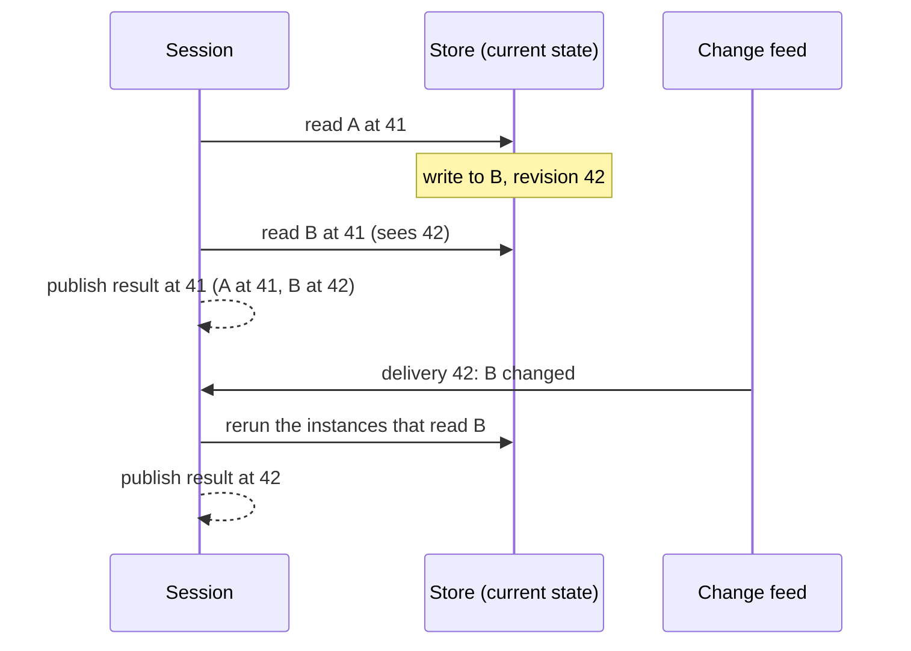

# Consistency

See the [architecture overview](overview.md) for the broader system context,
[Stores and change feeds](stores.md) for where revisions come from, and
[Guarantees](guarantees.md) for the contract this document explains.

Consistency in Refresher is about reads: which moment a result reflects, how
results move forward, and how they catch up with the data. Consistency of writes
belongs to whatever writes the data. Refresher works over any data source that
announces its changes, and a source that keeps history and commits atomically,
such as the transactional store, lets it promise more. See
[Two-component architecture](two-components.md).

## Revisions

A **revision** names a moment of a data source. The change feed owns them: each
delivery carries a revision greater than the last, and every change in it shares
that revision. Sessions over the same feed see comparable revisions.

A session's sense of time is the latest revision it has seen. Each execution
reads at that revision, and tags every read with it:

```ts
// Pseudo-implementation: one execution, one revision.
const revision = session.latestRevision; // 41
for (const round of execution.rounds()) {
  await Promise.all(
    round.reads.map((read) => read.store.answer(read, { at: revision })),
  );
}
```

## Reading at a revision

What a read tagged with a revision returns depends on the store:

- **A store that keeps history** answers as of that revision. All reads in one
  execution then see the same moment, and the result is a consistent snapshot.
  Changes committed while the execution runs don't affect it; they arrive as the
  next update.
- **A store that holds only current state** answers with what it has. A result
  may combine reads taken a moment apart.

A store may also answer from a moment earlier than its revision: a replica or a
cache that lags behind, or another session answering from what it already holds.
It reports the revision it answered from, and the answer is
[stale](#stale-answers).

The second case is safe for live queries. A read that sees a change before its
delivery arrives is still matched when the delivery does, and that schedules
another pass:



The first result mixes two moments, and the next one is consistent. Once changes
stop, every live query converges to the latest data.

A one-shot query has no next update, so over a current-state store its result
may stay mixed. Values that must be consistent with each other belong in a store
that keeps history, or in a live query.

An execution over stores of both kinds is a snapshot for the stores that keep
history, and converges for the rest.

## Stale answers

A store that answers from state older than the revision it was asked at reports
that state's revision, and its answer is **stale**. Every view instance that
reads it, directly or inline through other views, settles stale instead of
settled:

- It holds its result, which reflects at least the state of the oldest stale
  answer it read. That revision is its `validThrough`.
- A view that only holds a ref to it is unaffected. It never read its data, as
  with [caching](view-caching.md#what-is-cached).
- An execution never takes a stale instance from the view cache.

A settled result never reflects state older than its revision, so a stale one
is always marked.

Nothing reruns a stale instance on its own: matching changes against it would
only report what is already known. The session's
[controllers](lifecycles.md#controllers) decide what to do with it: show it while
asking for a fresh answer, wait for one, or fail. The fresh state arrives as a
change, which hits the stale read and every instance that read it.

A store that stops observing its changes says so with a change too, which hits
every read made through it before then, and answers stale until it observes
again. Otherwise results over it would keep validating as current, since
validation sees only the changes delivered. See
[When a store stops observing](stores.md#when-a-store-stops-observing).

That is what lets another session answer at once from what it holds, and catch
up later. See [Stale answers](federation.md#stale-answers) in federation. A
store that sees every change itself has no reason to answer stale.

## Validating an execution

An execution starts at revision `S`. When it finishes, the session takes the
latest revision delivered by then, `V`, and matches the changes in `(S, V]`
against the reads the execution recorded:

- **No hit.** Every read saw the same data throughout the execution, whichever
  moment within it the read took place. The result is consistent, and valid
  through `V`.
- **A hit.** The instances whose reads were hit are invalidated and rerun before
  anything is published, as after any later change.

Validation needs no history from the store and no knowledge of which stores keep
it: matching alone decides. A change a store exposes before its delivery escapes
validation, and is caught when the delivery arrives, as above.

Over a store that holds only current state, matching from the execution's
revision errs on the side of a hit. A read that took place later than `S`, or
saw a change before its delivery, is matched against changes it already
reflects, and may rerun once more than needed. A missed change would need a read
from before `S`, which a store gives only as a [stale answer](#stale-answers),
marked as such. A store that keeps history reads
exactly at `S`, so its reads match only the changes they missed.

Validation is also how a [cached result](view-caching.md) stays usable: an entry
read at an earlier revision is valid at `V` when no change in between hits its
reads. An entry read at a later revision is used as is, unless the stores it read
keep history; then its view reads again at `S`, and the execution stays a
snapshot.

## Batches and passes

A snapshot covers one execution, and an execution can serve several queries:

- **A batch** of queries started in the same round runs as one execution, so
  every query in it reads each source at one revision. See
  [Batches](queries.md#batches).
- **A live-update pass** reruns every affected view instance, across every
  affected live query, at one revision, and publishes all their updates
  together. A consumer never sees one live query moved forward and another left
  behind by the same change.

Values that must stay consistent belong to one query, to one batch, or to live
queries in one session.

## Catching up

A live query that last published at revision `Q` catches up to a newer revision
`C` by matching every change delivered in `(Q, C]` against its recorded reads.
It needs one pass for the interval, whatever the number of changes in it, and it
may skip intermediate states.

- **A change counts once it is delivered,** even when a later one restores the
  previous value. The update still states the change as its cause.
- **What counts as a change is the store's answer.** A store that reports every
  write turns a write of an identical value into a change too.
- **Changes delivered while a pass runs** schedule another pass, and appear as a
  later update.
- **The first interval** begins at the revision of the first execution, so
  changes delivered before a subscriber attaches arrive as its first update.

Catching up needs no history from the store. The session matches changes as they
are delivered against recorded reads, so a live query catches up from them
alone. A live query that was released has no recorded reads, and restarts with
a reset. See [Lifecycles](lifecycles.md#live-queries).

## How much history

A store doesn't need to keep history indefinitely. Catching up needs none, so
a window wide enough to cover a single execution is enough: from the revision it
pins to its last read.

An execution that outlasts the window pins a revision the store no longer holds.
The store then fails the read, and the execution restarts at the latest
revision; a live query publishes the restarted result as a reset.

## Across sessions

A federated result reads several sources, each with its own revisions:

- The result records the revision of each source it reflects.
- Each source is consistent on its own: what a remote session returns obeys the
  rules above for its own stores.
- Revisions of different sources aren't comparable, so a result is a snapshot
  per source and converges as a whole.

A remote store sends a batch with the revision to read at when the answering
session keeps history. See [Federation](federation.md).

## The application's side

These guarantees hold when the application keeps its side of the contract:

- **Report a change after it happens.** A read must already see a change by the
  time it is delivered.
- **Report the past as the past.** A read reflects its revision or a later one,
  or reports the older revision it answered from.
- **Report every change,** from every writer.
- **Never mutate a returned value.** Values from stores and views are treated as
  immutable; a store replaces a value to change it.

A broken rule shows up later and far from its cause, as a stale result or a
missed rerun. The tools in [Testing](testing.md) check these rules in
application tests.

## With the transactional store

The transactional store keeps history and commits atomically, so over it:

- Every execution is a snapshot across all its stores.
- A write that spans several stores is one revision and one delivery, so every
  result reflects it entirely or not at all.
- Its commit log is the change feed, so the application's side of the contract
  holds by construction.

How it keeps history, validates writes, and owns its storage is its own
concern. See [Two-component architecture](two-components.md).
