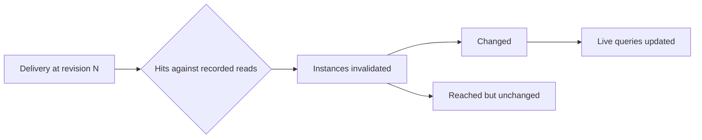
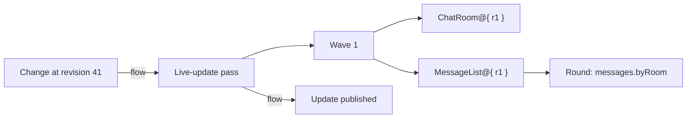

# Debugging, tracing and observability

See the [architecture overview](overview.md) for the broader system context, and
[Invalidation](invalidation.md) for the records presented here.

Reactive bugs are rarely about a single value. An update arrives and it is not
obvious which change caused it, or a view keeps showing old data and there is
no event to inspect at all. By the time a developer looks, the change that
started it has been delivered and forgotten.

Refresher answers these questions from records it keeps anyway: the reads each
instance recorded, the changes each delivery brought, and the reasons each
update carries. Debugging tools present those records; they never capture a
second, separate account of what happened.

| Question                     | Answered by                                      |
| ---------------------------- | ------------------------------------------------ |
| Why did this view rerun?     | [The update's reasons](#why-did-it-rerun)        |
| Why didn't this view rerun?  | [The counterfactual](#why-didnt-it-rerun)        |
| What did this change affect? | [The delivery's hits](#what-did-a-change-affect) |
| What is live right now?      | [Session inspection](#inspecting-a-session)      |
| Where did the time go?       | [The trace](#the-trace)                          |

For a React developer, these are the React DevTools questions: "why did this
render?", the component tree, and the Profiler timeline, asked about views.

## Why did it rerun

Every update other than a reset carries a [causal chain](invalidation.md#the-causal-chain)
for each instance that reran. A tool renders it from the instance outward:

```
ChatRoom@{ roomId: "r1" }  reran
  ← invalidated: read `messages.byRoom` range { roomId: "r1" }
                 hit by revision 41 (operation "sendMessage")
  ← source: transaction 9f2c, started by "composer.submit"
```

The chain ends in a change, a non-determinism declaration, or a reset. A chain
that continues past the change is the [source's own cause](invalidation.md#causes-beyond-the-change),
carried as given.

A tool can also show the **diff** behind a rebinding: a ref is a view and its
arguments, so the old and new refs show exactly which argument moved.

## Why didn't it rerun

A view that kept old data is the bug with no event to inspect. A tool answers it
by taking the view's recorded reads and the change the developer expected to
reach it, and running the same intersection invalidation runs:

```
MessageList@{ roomId: "r1" }  did not rerun for revision 42
  read `messages.byRoom` range { roomId: "r1" }   not hit: change is in room "r2"
  read `users` key "u1", fields [displayName]     not hit: change wrote `avatar`
```

This is the counterfactual: the intersection that didn't produce a hit. It has
three outcomes, and a tool keeps them apart:

- **Not hit.** The view didn't depend on what changed. Working as intended.
- **Hit, unchanged.** The view reran and produced the same value, so the
  ripple stopped.
- **Never read.** No recorded read covers the data. The view derived a value
  from something Refresher can't see, such as a closure, a module-level cache,
  or the clock, so it has nothing to intersect and never reruns.

The third outcome is the real defect. Telling it apart from the first requires
knowing what was recorded, which is why the reads themselves are kept, along
with every verdict. A tool can list a view's reads next to its arguments, so a missing read
stands out before any change arrives.

## What did a change affect

The reverse direction groups the same hits by delivery:



A tool can show it as a tree from the change outward, which is how a developer
finds the view an unexpected write disturbed. Both ingredients are already kept
for their own reasons, the delivery and the reads each instance recorded, so the
answer is derived when asked.

The answer stays **open** for a while. A live query's pass may
[catch up](consistency.md#catching-up) later and add to what a delivery reached.
Entries are only ever added. A released live query no longer has recorded reads,
so what it would have reached is gone, and the answer says so.

## Inspecting a session

A session can be inspected while it runs, the way React DevTools shows the
component tree:

- **Live queries**, with their root, their state (active, released),
  their driver, and the revision of their last update.
- **Instances**, as a graph joined by refs. An instance reached from several
  live queries appears once, with every query that holds it.
- **Recorded reads** for each instance, described in the
  [shared vocabulary](invalidation.md#describing-a-read) of
  `kind`, `fields`, and `detail`, so any store renders the same way.
- **Cache entries**, when [view caching](view-caching.md) is on, with the
  revision each is current at, and the window of revisions the change log
  holds.
- **Errors** held by each instance, with their kind. See [Errors](errors.md).

Instances are labelled by their view's `name` and their arguments. Without a
`name`, a tool falls back to the view's id.

## The trace

A session can emit a synthetic [Perfetto](https://perfetto.dev) trace, so a
whole session can be read on one timeline:



- **Tracks** are the session, its live queries, and its stores.
- **Slices** are executions and their steps: passes, waves, view evaluations,
  and the rounds of batched reads they wait on. See [Execution](execution.md).
- **Flows** connect a change to each instance it invalidated and to the update
  that published the result.

The trace is built from the same events as the records above, so a slice and an
explanation never disagree about what happened.

## Across sessions

With [federation](federation.md), a view's reads may be answered by another
session. Each session traces its own work, and the trace links them through the
remote store: a change in a worker flows to the push that carried it, and on to
the instances it invalidated in the main session. A causal chain crosses the
same boundary, so "why did this rerun" can end in a write made in another
session.

## Cost

Recording reads and reasons is unconditional: invalidation needs the reads, and
updates carry their reasons. Explanations are derived only when asked, so an
unaffected view never pays for one.

Tracing and session inspection are opt-in. While disabled, they add nothing to
execution beyond the records kept anyway.

## What is guaranteed

1. **One account.** Explanations, inspection, and traces are derived from the
   records invalidation uses, so a tool never contradicts what the session did.
2. **Observing changes nothing.** Enabling tracing or inspection never changes
   results, updates, or their reasons.
3. **Gaps are explicit.** A reset, a released live query, or a cause the source
   didn't provide is shown as such.

## Discussion and ideas

- **A browser extension.** A devtools panel that shows session inspection next
  to the React component tree, linking each component to the roots it holds.
- **Recording and replay.** A delivery log plus recorded reads is enough to
  replay what a session saw, which may turn a hard-to-reproduce bug into a file.
