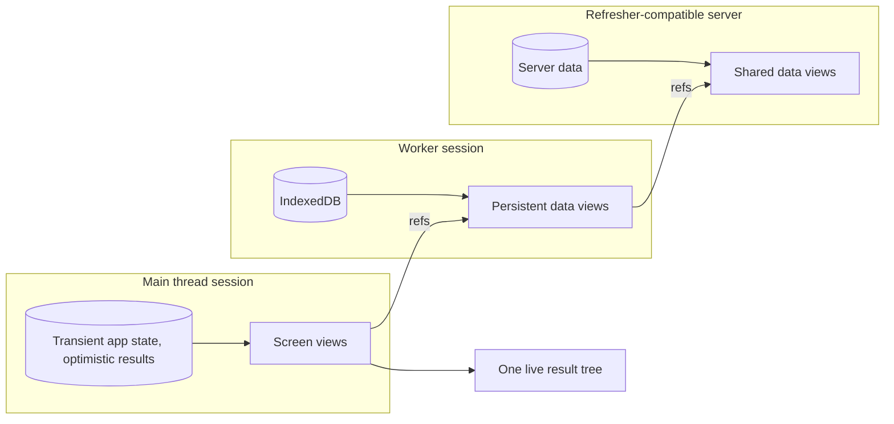

# Environments

See the [architecture overview](overview.md) for the broader system context,
[Sessions](session.md) for what a session owns, and [Linking](linking.md) for
how a view is addressed across a boundary.

Refresher runs on the main thread, in a dedicated or shared worker, or on a
server. The programming model is the same in every environment: views, refs,
and queries behave identically, and each environment runs its own
[session](session.md) over its own data.

## Choosing an environment

Each environment suits a different kind of state:

| Environment      | Suits                                                        | Trade-off                                                    |
| ---------------- | ------------------------------------------------------------ | ------------------------------------------------------------ |
| Main thread      | Transient app state: UI state, drafts, optimistic results    | Views share the thread with rendering                        |
| Dedicated worker | Persistent data over IndexedDB, and views that do heavy work | Results cross a thread boundary; one worker per tab          |
| Shared worker    | Persistent data shared by every tab of an application        | Results cross a thread boundary; views run once for all tabs |
| Server           | Data shared between users and devices                        | Results cross a network; latency per round trip              |

The guiding rule is the one React applies to state: keep a view next to the
data it reads. A view over UI state runs on the main thread, so opening a menu
reruns main-thread views and sends nothing to the worker. A view over IndexedDB
runs in the worker, so a page of messages crosses the boundary once, already
composed.

Most applications use more than one environment, and
[federation](#federation) connects them into one view graph.

## What crosses a boundary

Sessions in different environments exchange only data. What crosses is:

- **Requests:** a view's id and its encoded arguments.
- **Answers:** a view's result, encoded by the query driver that carries
  it, with the refs inside it left as refs. Refs cross as ids; see
  [Linking](linking.md).
- **Revisions:** each answer is stamped with the revision of the source that
  produced it.
- **Failures:** a failed view is an answer too, carrying its errors as data.

Sessions that exchange values must agree on the encoding. A value the encoding
cannot carry stays in its environment: a main-thread view may hold DOM nodes or
other host objects, as long as nothing asks for it from another session.

The consumer of a query receives materialized results in its own environment.
A React component on the main thread reads a live query on the main-thread
session, whether the data behind it lives on the main thread, in a worker, or on
a server.

## Constraints

Crossing a boundary has costs, and the architecture is shaped to keep them low:

- **Encoding.** Every crossing encodes and decodes a value. Answers are shallow
  — refs stay refs — so a session receives only what it asked for.
- **Latency.** Every round trip waits on a thread hop or a network. A session
  sends all of a round's requests to another session in one batch, and an
  answer may include the instances its reader will reach next, so a
  screen loads in few round trips.
- **Trust.** A session answering requests from another environment it does not
  fully trust, such as a server answering browsers, can validate arguments and
  results with a strict, schema-aware codec. See [Codec](codec.md).
- **Lifetime.** A worker may be terminated and a network connection may drop.
  Losing another session fails the operations that depend on it with an
  **operation** error, and a live query that reconnects starts with a reset.
  See [Errors](errors.md).

## Federation

> **Design in progress.** Federation is still being designed; this section
> describes its intent.

**Federated execution** lets a session read views that another session runs,
receiving their results and updates as if they were local. The main thread
holds transient app state, a worker holds persistent data, and a server holds
shared data, and one view graph mixes all three.

A session sees another session as a store: its live queries to that session
are store views, and their updates invalidate local views like any change. A
server joins a federated graph by implementing the same protocol. See
[Federation](federation.md).
