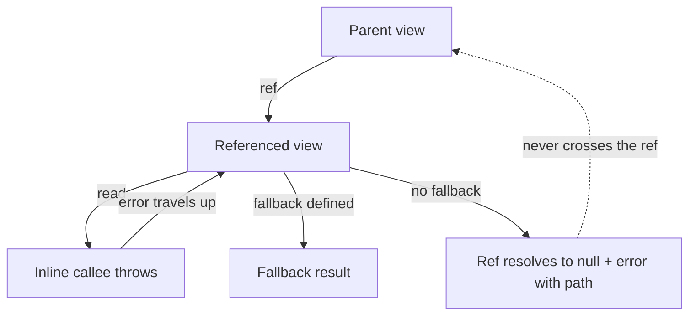

# Errors

> **Design in progress.** Error handling, including fallbacks, is still being
> designed and may change.

See the [architecture overview](overview.md) for the broader system context,
[Execution](execution.md) for query drivers, and
[Guarantees](guarantees.md) for the contract.

## Error kinds

Errors in Refresher are data. Every failure names the thing that failed, and the
set of names is closed, so a consumer can handle failures exhaustively:

- **store** — a store definition is malformed or unknown to the session, or the
  store is temporarily unable to answer.
- **view** — a view definition, or its id, is wrong.
- **ref** — a `ref()` or `read()` call named a target it cannot reference: one
  that resolves to nothing, or one the caller may not consume.
- **value** — a view's `resolve` threw, or returned something the session's value
  codec rejected.
- **session** — the session is unknown or disposed, or its options are invalid.
- **operation** — the operation could not start or continue, for example because
  a resource limit was exhausted or a connection to another session was lost.
- **internal** — an invariant of Refresher itself was violated. Nothing a caller
  can act on.

A narrower diagnostic sits inside each name. The set of names is fixed; the set
of diagnostics is not, so a consumer that does not recognize a diagnostic falls
back to the name.

Value and ref failures belong to a node of the result: they carry a path and
leave the rest of the result intact. The others have nothing to attach to and no
meaningful partial result, so they reject the operation instead — which is what
lets a returned result be trusted.

## Where an error stops

How far a failure travels depends on how the failing view was consumed.

An inline **read** fails its reader, just as a thrown error fails the function
that called it. The failure travels up through inline reads until it reaches a
view that defines a [fallback](#fallbacks), or the nearest ref boundary.

A **ref** is an error boundary, and a failure never crosses it. When a
referenced view fails and defines no fallback, the ref resolves to `null` and
the error is reported with the path to where it happened. The parent has already
produced its result, so it is unaffected — its own fallback is not called — and
so are its siblings.



This differs from React, where an error boundary catches errors from any
descendant component. In Refresher every ref is its own boundary. A consumer
that wants React-style bubbling can rethrow the reported error in its component
and let a React error boundary handle it.

A view may also catch a failed inline read with `try`/`catch` and return
something else. That is ordinary control flow: the engine sees whatever the view
returns as a successful result, so the failure is neither reported nor marked on
the result. Use a fallback when the result should still count as a failure.

## Fallbacks

A view can define a **fallback**: an error representation that replaces its own
result when it fails, much like a React error boundary renders fallback UI
instead of a failed subtree.

```js
const postLikes = view({
  resolve: (postId, { read }) => read(likes.record, postId),
  fallback: (error, postId) => ({ present: false }),
});
```

A fallback applies wherever its view is consumed. A reader that reads the view
inline receives the fallback result instead of a thrown error, and a ref to the
view resolves to the fallback result instead of `null`.

A fallback returns the view's own result type. If an application wants to tell
a failure apart from ordinary data, it models that in the view's result type —
for example, as a discriminated union — and Refresher never reshapes result
types on its own.

A fallback must not fail. It is synchronous and pure and performs no reads: it
is a function of the error and the view's arguments only. A fallback that throws
anyway is treated as a failure of its view without a fallback.

A fallback result is still a failure as far as the engine is concerned. The
error is reported and visible to debugging tools, and the result is marked as
coming from a fallback. The view keeps the reads it recorded before failing, so
a later change that intersects them reruns the view and can recover it.

## Nullability

A ref's resolved value is nullable unless Refresher can guarantee a result:

| Ref                                                 | Resolved type |
| --------------------------------------------------- | ------------- |
| To a view without a fallback                        | `T \| null`   |
| To an imported view with a fallback                 | `T`           |
| Decoded from data (an [encoded ref](#encoded-refs)) | `T \| null`   |

## Presentation belongs to the consumer

Where a failure stops is a rule of the graph: at the failing view's fallback, or
at the nearest ref. How a failure that reached a ref is presented is decided by
the [query driver](execution.md), because reporting is part of what the
consumer asked for. The same failed ref is a `null` with a collected error in
Refresher's own result format, a nulled field with an entry in `errors` under a
GraphQL executor, and a thrown error that a React error boundary can catch under
the React reconciler.

## Failures in live queries

A failure contained in a node is part of a live query's result like any other
change: the ref becomes `null`, or holds its fallback result, and recovers when
a later change lets the view succeed.

A failure that rejects a pass — an operation failure, for example — has no
result to publish. The live query keeps its last good result and reports the
failure alongside it, so consumers never lose data they already displayed.

## Encoded refs

A ref decoded from data carries an id rather than a definition, so it can fail
in a way an imported reference cannot: resolving to nothing. So can a `ref()` or
`read()` call that names a target the caller may not consume, such as a
non-deterministic view read from a deterministic one. Either way the failure is
about the reference rather than about either view.

Such a failure is a **ref** failure. A failed `ref()` resolves to `null` at its
boundary; a failed `read()` throws into its reader and travels like any inline
failure. Because the target view is unknown or may not be consumed, its fallback
does not run, so an encoded ref is always nullable. A view published by another
session runs its fallback in that session, before its result crosses the
boundary. See [Linking](linking.md).
