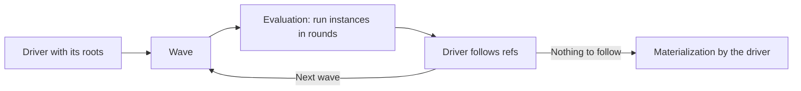
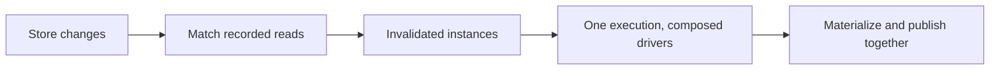

# Execution

See the [architecture overview](overview.md) for context, [Views](views.md) for
what execution runs, and [Consistency](consistency.md) for the revision it
reads at.

Execution turns views into results. It runs views, which read other views inline
or return refs to them, down to the store views that read the stores, and
records every store read. It only reads, and every execution reads at one
revision.

A [query driver](#query-drivers) steers each execution. Execution evaluates a
**wave** of instances, starting with the driver's roots. When a wave settles,
the driver [follows](#following-refs) the refs it chooses into the next wave,
until nothing is left to follow, and then **materializes** its output.



The same loop serves a query's first run and its live updates; only the first
wave differs.

## An example

A chat screen from the federated chat example, with one root, `App(null)`, and
the standard driver, which follows every ref:

```ts
const wave1 = {
  "App(null)": { sidebar: ref(Sidebar, null), room: ref(Room, "a") },
};
// Both instances share rounds
const wave2 = {
  "Sidebar(null)": { chats: [ref(ChatLink, "a"), ref(ChatLink, "b")] },
  'Room("a")': {
    title: "Design",
    messages: [ref(Message, 1), ref(Message, 2)],
  },
};
// Both chat links read their records in one batch
const wave3 = {
  'ChatLink("a")': { title: "Design" },
  'ChatLink("b")': { title: "Lunch" },
  "Message(1)": { text: "Hi!", author: ref(Profile, "ada") },
  "Message(2)": { text: "Ship it", author: ref(Profile, "ada") },
};
// Two refs lead to one instance; it holds no refs, so the loop ends
const wave4 = { 'Profile("ada")': { name: "Ada" } };
```

The standard driver materializes one JSON tree per root. A GraphQL driver
running `{ sidebar { chats { title } } }` never follows `room`, so nothing
beneath it runs.

## Evaluation

Evaluation runs a wave's instances and returns each one's value, with refs left
standing, its store reads and its failures. Each instance runs at most once per
execution, however many refs lead to it.

A view consumes another view in two ways:

- `read` evaluates it inline. Its reads and failures belong to the caller.
- `ref` returns an address. It runs in a later wave, if the driver follows it.

### Rounds

Within a wave, evaluation proceeds in rounds, with no prefetch declaration.
Every running instance runs until it waits on its own pending reads; those reads
form the round, and each store answers its share as one batch. All instances of
a wave share rounds, whichever roots they serve: independent reads in sibling
views share a round, and a chain of dependent reads costs one round per link.
See [Views](views.md#batching-reads).

A round forms once every instance has run as far as it can, never on a timer, so
execution is deterministic: the same waves and answers give the same rounds.
Evaluation adds no asynchrony: a wave whose reads all answer synchronously
settles in the calling task.

### Instance status

An instance is **running**, **settled** with its result and the reads it made,
or **stale** once a change reaches those reads. Without its result, an instance
is a **descriptor**: which instance it is, and what to match changes against.
[Invalidation](invalidation.md) and live queries work on descriptors. An
execution reuses a cached instance only while it is valid at the execution's
revision; see [View caching](view-caching.md#validation).

## Following refs

When a wave settles, the driver chooses which refs to follow next, and when,
reading no store. It finds them **statically**, from a query such as a GraphQL
selection set, or **dynamically**, by walking values and selecting by view or
[meta](views.md#refs-and-boundaries). A ref it doesn't follow is never
evaluated, except a [pin](pins.md)'s target. A ref with
[open inputs](variables.md#queries) is bound before it is followed, and an
[action ref](actions.md) is never followed. Breadth-first batches best; a
streaming driver may go deeper first to show a child sooner.

Following a ref expands it now, up to the [bounds](#bounds), so a destination to
navigate to later belongs in arguments. See [Pagination](pagination.md).

## Query drivers

A query driver pairs **demand**, which refs to follow and what applies beneath
each, with a **materializer**, the output the consumer receives. Both usually
come from one artifact: a GraphQL selection set, a React component tree, an
OpenAPI response schema.

| Driver           | Demand                    | Materialization                                         |
| ---------------- | ------------------------- | ------------------------------------------------------- |
| Standard query   | Every ref                 | One value per root; failed refs as `null` with an error |
| Federation host  | None: answers are shallow | Values encoded with [view ids](linking.md#view-ids)     |
| GraphQL executor | The selection set         | A GraphQL response                                      |
| React reconciler | The component tree        | Rendered components (open direction)                    |

A query is a driver and its roots. How many executions a run takes is the
driver's choice, and a restart starts a new one. Several drivers share one
execution behind a driver that composes them.

Only the driver knows which refs it follows, so each result reports the edges
it traversed: under each instance it searched, the instances it leads to. The
runtime keeps them, replacing an instance's edges when it runs again. When a
restart drops an edge, as when a chat is no longer selected, the runtime walks
the edges from the roots once the run finishes, and stops matching changes
against every instance it no longer reaches, as a garbage collector would. A
driver that reports no edges keeps everything a long-lived query ever read
subscribed, and every update pass pays for it.

The edges also let a restart run in the waves a start would. The simple driver
walks from the roots again, through valid instances by their kept edges, without
running them: the first wave runs the stale instances reached through valid ones
alone, each later one those the last wave's results lead to. A stale instance
runs only after the stale ones above it, and not at all once they no longer lead
to it, as when a chat stops being selected: the runtime drops it with what only
it reached. Waves hold whatever the walk reached, from any depth, so there are no
empty ones; nothing stale reached, nothing runs.

Views never see drivers, so a view's result depends only on its arguments and
data, and instances are shared across drivers.

Materialization is the driver's: at the end, or payload by payload. A live
update covers what ran, and the consumer merges it into what it holds. Because
it works on plain values and refs, evaluation can run in a worker while the
main thread materializes. See [Environments](environments.md).

> **Design in progress.** Failures are data on each instance, and the driver
> presents them: `null` with an error, GraphQL nullability, or a React error
> boundary. See [Errors](errors.md).

> **Open.** Serializable demand would let a server follow refs for a consumer.

## Comparison with GraphQL

| GraphQL                                 | Refresher                                        |
| --------------------------------------- | ------------------------------------------------ |
| Resolver                                | View                                             |
| Selection set                           | A driver's demand                                |
| Depth-first resolution                  | Breadth-first by default, chosen by the driver   |
| DataLoader                              | Rounds                                           |
| A field error nulls the nullable parent | A failure stops at the nearest ref or fallback   |
| Subscriptions push events               | Live queries rerun instances whose reads changed |

## Execution paths

### Query

A driver runs a query at the latest revision. A one-shot query keeps nothing,
apart from [view caching](view-caching.md).

### Live-update pass



The instances a change invalidates, across live queries, are the roots of one
execution, steered by a driver composing their drivers. A live query keeps only
[descriptors](#instance-status), so only invalidated instances run, and a child
refreshes without rerunning its parent; the consumer keeps the rest from earlier
updates. A change arriving during a pass schedules another. Updates are
published together, with their cause. See [Invalidation](invalidation.md).

The environment decides when a pass starts: a UI thread starts it at once, so a
write renders in the task that made it; a worker or server waits, gathering more
changes into one pass.

## Bounds

Waves, instances and inline-read depth are bounded, and exhausting a bound
rejects the execution. How much one view returns, such as a page, is its own
argument. See [Configuration](configuration.md).
