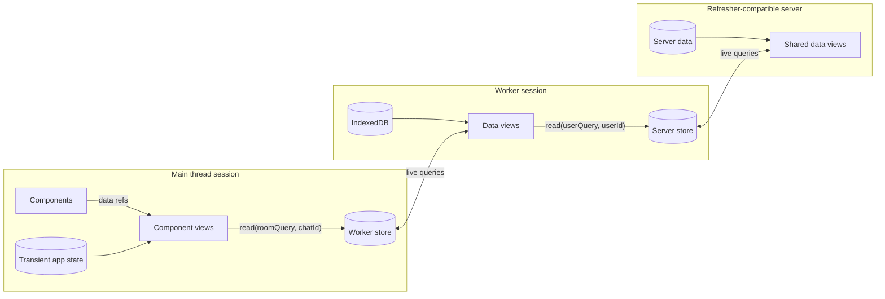
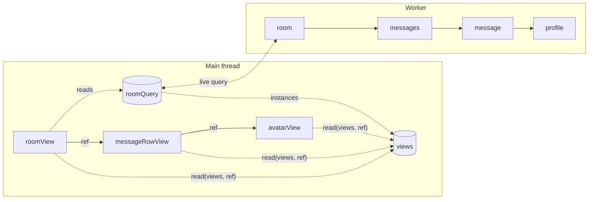
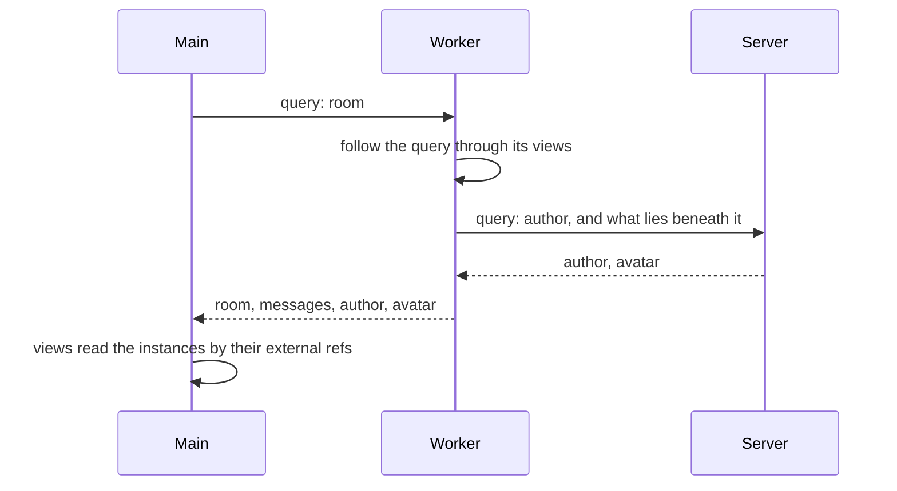
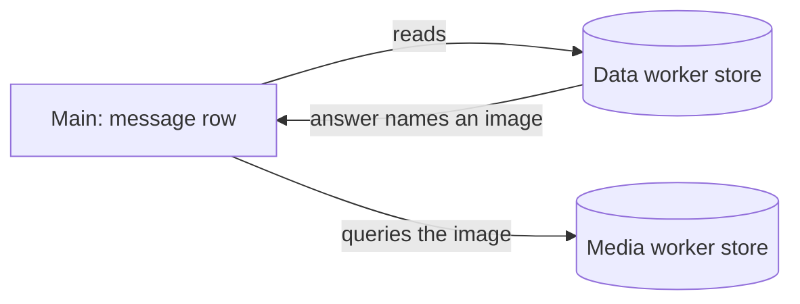
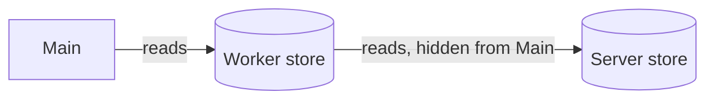
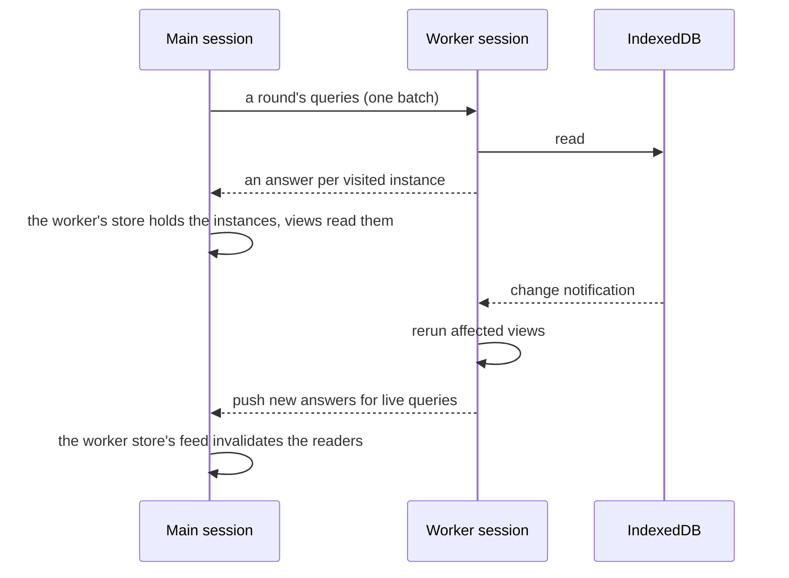
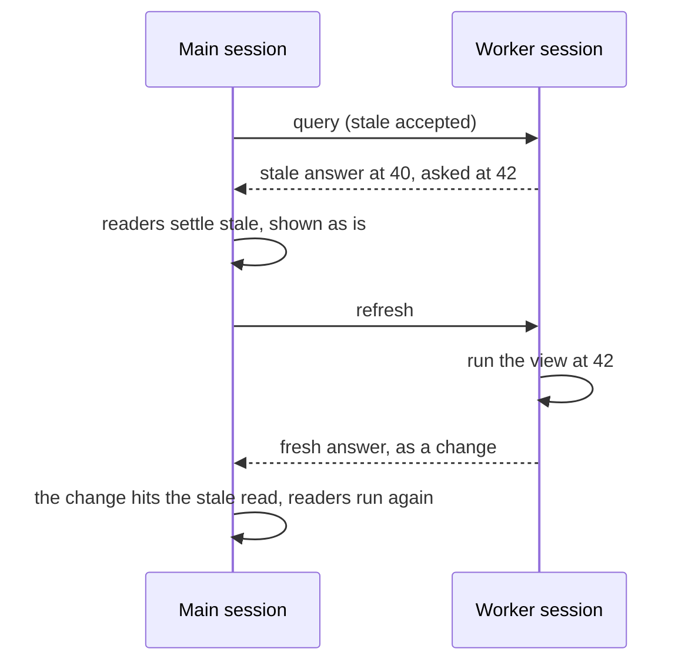

# Federation

See the [architecture overview](overview.md) for the broader system context,
[Environments](environments.md) for where sessions run,
[Stores and change feeds](stores.md) for how a session reads data it does not
own, and [Linking](linking.md) for how ids resolve to views.

> **Design in progress.** Federation is still being designed; this document
> describes its intent.

**Federated execution** lets a session use views that another session runs,
receiving their results and updates as if they were local. The main thread
holds transient app state, a worker holds persistent data, and a server holds
shared data, and one view graph mixes all three.

Federation is built from the primitives a single session already has: queries
and store views. A remote session is seen as a store, and each of its views the
asking session reads as an **external view**, a store view of that store. Each
update from the remote session updates its store view and invalidates the local
views that read it, as with any store. Views read another session's data the way
they read IndexedDB, and the [external refs](#reading-external-refs) its
answers hold are keys of another store view of the remote store.

In Refresher's design every view instance is independent, so every instance the
remote queries bring is answered on its own, and its external ref reads it.

The session that reads is the **asking** session, and the session that runs the
view is the **answering** session. The asking session holds a **remote store**
for each session it reads from; how the answering session computes its results
is its own concern.



Federation is one strict model, small enough to be written down as a
[protocol](#the-protocol) that a server can implement; the protocol itself is
still to be designed. Everything beyond it is
an [extension point](#extension-points) for later.

## Reading another session's views

A session reads another session's views in two ways:

```ts
// main/Room.tsx: an external view, declared at module scope.
export const roomQuery = worker.external<typeof data.room, RoomFollowed>(
  "ChatRoomV1",
);

// Starts a remote query, by the view's own arguments.
const { summaryRef, messagesRef } = await read(roomQuery, chatId);

// main/MessageRow.tsx: reads an instance a query brought, by its external ref.
const { text, author } = read(worker.views, messageRef);
```

- **`read(externalView, args)`** reads an **external view**, such as
  `roomQuery`: a view of another session, typed by a type-only import of it and
  [how far its query goes](#how-far-a-query-goes). It starts a live query in the
  worker, or joins one already running, and returns the root's result. It is no
  different from reading a store view, so it suits low-latency connections, such
  as a worker next to the main thread, as much as a server.
- **`read(worker.views, ref)`** reads an **external ref**: a ref to an
  instance another session runs, as an external view's answer holds it, by the
  remote store's view of those instances. It never starts a query: it returns
  the current result of the instance the ref names, at once.

An external view's answer holds external refs wherever it holds refs, so a root
view reads an external view and passes the refs it finds downstream. A view
gets external refs as arguments, or in the values it reads; see
[Layered views](#layered-views). A ref of the session's own is never read; see
[Access](views.md#access).

### Reading external refs

An external ref is an encoded ref: a string or a number, in a format the two
sessions agree on. Since it is data to the session holding it, it may be a
view's argument or a store view's key, and equal refs are `===`. It is typed,
`ExternalRef<Result>`, by the result of the view it names, and by what its query
followed; see [Followed refs](#followed-refs). `ExternalRefFor<V>` names one to
an instance of `V`. A plain string or number is
not one: only what decodes another session's answers, such as a remote store,
makes external refs.

A readable view keyed by followed refs reads them, typically a remote store's
`views`: a store view over the connection the refs arrive through, which
answers at once. The reader names the store, so routing is explicit, and each
remote store has its own `views`. A view that leaves its result `unknown`,
as `views` does, is typed by the ref: `read(worker.views, messageRef)`
returns the message view's result.

### Followed refs

A query brings the instances its root's refs lead to only as far as it
[goes](#how-far-a-query-goes); every other ref in its answer reaches the store
without its instance. An external ref says which are which by its second type
parameter, `ExternalRef<Result, Followed>`: `Followed` is the union of the
results of the views its query followed refs to. An external view declares it,
`worker.external<typeof data.room, RoomFollowed>("ChatRoomV1")`, and its answer
carries it down:

- A ref whose result is in `Followed` is followed, a `FollowedRef`: `views`
  reads it, and the refs in its result are followed as the same query followed
  them.
- Any other ref is `ExternalRef<Result>`, with `Followed` left `never`: it can
  be passed on, compared, or used as a key, and reading it fails to compile. A
  view that needs it starts a query of its own through an external view.

A ref carries results, never arguments, so an answering session can keep its
views' arguments to itself. `Followed` names results for the same reason, so
views with the same result type are not told apart, and a result's subtype
counts as followed. A ref from a query that followed more fits where less is
required, and `ExternalRef<Result>` accepts every ref to a `Result`, followed or
not:

```ts
// What a room's query follows, by the worker's views it reaches.
type RoomFollowed = ResultOf<
  | typeof data.chat
  | typeof data.messages
  | typeof data.message
  | typeof data.profile
>;

// Reads the message, and its avatarRef is followed too.
const row = ({
  messageRef,
}: {
  messageRef: ExternalRefFor<typeof data.message, RoomFollowed>;
}) => read(worker.views, messageRef);

// Only compares refs: any message ref fits.
const isSame = (a: ExternalRefFor<typeof data.message>, b: typeof a) => a === b;
```

`Followed` is a promise the types take on trust: the external view's declaration
must match how far its query goes. The runtime backs it: reading a ref whose
instance the store does not hold fails. See [Errors](errors.md).

## Layered views

Views use another session the way components use views: through refs they
receive as arguments. Main-thread views sit next to their components, take the
worker's external refs as arguments, read them, and pass the refs they find to
their children:

- A root view starts a remote query with `read(roomQuery, chatId)`, and reads
  the instances the query brought with `read(worker.views, messageRef)`.
- A view takes external refs as arguments, like a component takes data refs as
  props.
- An external view describes [how far its query goes](#how-far-a-query-goes)
  beneath its root.

The answering session owns the graph its refs point into. Every external ref a
view reads is one the answering session produced, so a query can describe it in
advance, and a whole screen loads in one round trip. Every remote round trip has
a visible cause: a read of an external view.



The worker's views form the data graph, linked by refs:

```ts
// worker/views.ts
export const profile = view({
  id: "ChatProfileV1",
  resolve: (name: string) => profileOf(name),
});

export const message = view({
  id: "ChatMessageV1",
  resolve: async (id: string, { read, ref }) => {
    const m = await read(messageRecord, id);
    return {
      text: m.text,
      author: m.author,
      avatarRef: ref(profile, m.author),
    };
  },
});

export const messages = view({
  id: "ChatMessagesV1",
  resolve: async (chatId: string, { read, ref }) =>
    (await read(chatMessages, chatId)).map((m) => ref(message, m.id)),
});

export const room = view({
  id: "ChatRoomV1",
  access: { queryable: true },
  resolve: (chatId: string, { ref }) => ({
    summaryRef: ref(chat, chatId),
    messagesRef: ref(messages, chatId),
  }),
});

const worker = createSession({
  provider: idb,
  // Maps the view ids the main thread asks for to these views. See Linking.
  linker,
});
```

The main thread declares the worker's store once. Each view sits next to its
component:

```ts
// main/worker.ts
export const worker = remoteStore("data-worker");

/** What a room's query follows. See Followed refs. */
export type RoomFollowed = ResultOf<
  | typeof data.chat
  | typeof data.messages
  | typeof data.message
  | typeof data.profile
>;

// main/MessageRow.tsx
import type * as data from "../worker/views";

export const avatarView = view({
  resolve: (
    {
      profileRef,
    }: { profileRef: ExternalRefFor<typeof data.profile, RoomFollowed> },
    { read },
  ) => {
    const { initials, hue } = read(worker.views, profileRef);
    return { initials, hue };
  },
});

export const messageRowView = view({
  resolve: (
    {
      messageRef,
    }: { messageRef: ExternalRefFor<typeof data.message, RoomFollowed> },
    { read, ref },
  ) => {
    const { text, author, avatarRef } = read(worker.views, messageRef);
    return {
      text,
      author,
      avatarRef: ref(avatarView, { profileRef: avatarRef }),
    };
  },
});

// main/Room.tsx
export const roomQuery = worker.external<typeof data.room, RoomFollowed>(
  "ChatRoomV1",
);

export const roomView = view({
  resolve: async (chatId: string, { read, ref }) => {
    const { summaryRef, messagesRef } = await read(roomQuery, chatId);
    return {
      headerRef: ref(headerView, { summaryRef }),
      rowRefs: read(worker.views, messagesRef).map((messageRef) =>
        ref(messageRowView, { messageRef }),
      ),
    };
  },
});

// main/App.tsx
export const appView = view({
  resolve: async (_: undefined, { read, ref }) => {
    const chatId = await read(activeChat);
    return { roomRef: chatId === null ? null : ref(roomView, chatId) };
  },
});
```

An external view is typed by the view it stands for, a queryable one, and its
answer by `External<Result>`: the view's result with every ref in it an external
ref. Reading an `ExternalRefFor<typeof data.message>` returns the message view's
result, at once, with its refs external in turn.

## Keys and sharing

External views and external refs are read like local store views:

- **An external view starts or joins a remote query** from the arguments it is
  read with. The instances its query visits are shared with other queries.
- **Instances are keyed by their external refs**, and shared by every query
  that visits them. An instance stays while some query visits it.
- **Values are shallow.** A result read through an external view or an external
  ref holds the answering session's refs as external refs, which the reader
  passes on or reads in turn.

Every such read is recorded like any store view read, and its matching
test is exact: a pushed change names the refs whose answers changed, and it
matches the reads of those refs. See [Read tracking](views.md#read-tracking).

`read(worker.views, ref)` answers synchronously, since it reads only what
the store holds.
An external view answers synchronously when its query already runs, and
otherwise joins the current round.

## Addressing by id

A session answers for the views its [linker](linking.md#linking-ids) maps
ids to, and a view in another session refers to one of them by an external
view, typed by a type-only import. A view reached this way is reached only by
id, so it must be queryable, and a view its answers hold refs to must be
referenceable.

An answer carries the refs its value holds as **encoded refs**. Each one names
a view id and arguments. The answering session encodes the refs in its answers,
and the asking session holds them as they are, as external refs. Plain ids,
signed tokens and encrypted handles all fit, as long as the two ends agree. An
external ref is a string or a number, opaque to the views that receive it: they
read it and pass it on, and since it is data to their session, it may be an
argument, where the session's own refs may not. See
[Views](views.md#refs-and-boundaries).

The view that reads an external ref names the store it reads it from, so
routing is explicit. An external ref its store does not hold fails with a
**ref** error, like a ref to an unknown id. See [Errors](errors.md).

An answer encodes [action refs](actions.md) too, and the asking session holds
them as **external action refs**: strings or numbers, typed by the action they
name and the inputs they leave open. They are data like external refs, but
never read: the application's runner runs them.

With a plain JSON encoding, an encoded ref inside an answer looks like this:

```json
{
  "text": "Hi!",
  "author": "Ada",
  "avatarRef": "[\"ChatProfileV1\",\"Ada\"]"
}
```

A session answers for every id it publishes. An answer may hold refs to any id;
a ref nobody reads needs nothing behind it.

## How far a query goes

An external view describes how far its query goes: the refs beneath its root
that its readers and their children will read. The answering session follows
that description through its own views, and answers every instance it visits,
each on its own with its refs encoded. Without one, the answering session's
query driver decides how far to go, as any query driver does.

The room's query brings the room, its summary, its messages and every author's
profile in one round trip. The main thread's views then read every external ref
at once, and the whole tree resolves in one round.

A ref the query did not visit reaches the store without its instance, and its
type says so: it is not [followed](#followed-refs), and reading it fails to
compile. A view that renders a child behind a Suspense boundary can leave the
child out of its query, and the child starts its own query when it resolves,
much like GraphQL's `@defer`.

### Across the boundary

In a chain, the answering session forwards the part of a query that reaches
another session's refs with its own queries, so a tree spanning three sessions
loads in about one round trip per session.



A query, and the answers it brings back, in a plain JSON encoding:

```json
{
  "queries": [{ "view": "ChatRoomV1", "args": "c1" }],
  "answers": [
    {
      "ref": "[\"ChatRoomV1\",\"c1\"]",
      "value": {
        "summaryRef": "[\"ChatV1\",\"c1\"]",
        "messagesRef": "[\"ChatMessagesV1\",\"c1\"]"
      }
    },
    { "ref": "[\"ChatV1\",\"c1\"]", "value": { "title": "Lunch", "count": 1 } },
    {
      "ref": "[\"ChatMessagesV1\",\"c1\"]",
      "value": ["[\"ChatMessageV1\",\"m1\"]"]
    },
    {
      "ref": "[\"ChatMessageV1\",\"m1\"]",
      "value": {
        "text": "Hi!",
        "author": "Ada",
        "avatarRef": "[\"ChatProfileV1\",\"Ada\"]"
      }
    },
    {
      "ref": "[\"ChatProfileV1\",\"Ada\"]",
      "value": { "initials": "A", "hue": 210 }
    }
  ]
}
```

Two rules keep this safe:

- **Queries are explicit.** A remote round trip happens only where a view reads
  an external view, and a view that reads past what its queries brought fails
  visibly.
- **Answers stay per instance.** Every instance a query brings is shared by its
  external ref, and kept live on its own.

## Patterns

The same model covers four more arrangements of sessions.

### Several answering sessions

The main thread reads from a data worker and a media worker, or from several
servers, each through its own remote store. Each external ref is read through
the `views` of the store it came from. A data worker answer can name a
media image, and the main thread queries it through the media worker's store.
Each store keeps its own revisions, and the result records each of them.



```ts
// data worker
export const message = view({
  resolve: async (id: string, { read }) => {
    const m = await read(messageRecord, id);
    return { text: m.text, imageId: m.imageId };
  },
});

// main: a store per worker, each with its own views.
export const dataWorker = remoteStore("data-worker");
export const mediaWorker = remoteStore("media-worker");

export const messageRowView = view({
  resolve: (
    {
      messageRef,
    }: { messageRef: ExternalRefFor<typeof data.message, RoomFollowed> },
    { read, ref },
  ) => {
    const { text, imageId } = read(dataWorker.views, messageRef);
    return { text, imageRef: imageId && ref(imageView, imageId) };
  },
});

export const imageQuery =
  mediaWorker.external<typeof media.image>("MediaImageV1");

export const imageView = view({
  resolve: (imageId: string, { read }) => read(imageQuery, imageId),
});
```

The data worker answers the message with the image's id, and the main thread
then queries the image from the media worker: two round trips, one after the
other.

### Chains

The main thread asks a worker, and the worker asks a server through its own
remote store. A worker answer may hold an external ref to a server view, which
the worker's remote store builds, and the main thread reads it through the
worker's store; the worker answers it from the server's. Chains stay hidden, so
each connection is a pair, and the protocol between two sessions never mentions
a third.



```ts
// worker: the server's store builds external refs to the server's views.
export const server = remoteStore("server");

export const message = view({
  resolve: async (id: string, { read }) => {
    const m = await read(messageRecord, id);
    return {
      text: m.text,
      authorRef: server.ref<typeof api.user>("UserV1", m.authorId),
    };
  },
});
```

The main thread's query reaches the worker, which forwards the part beneath
`authorRef` to the server, and the author arrives in the worker's store with
the rest of the query.

### Refs both ways

The answering session can read the asking session's views too, through a
remote store of its own, and the asking session answers in its own execution.
The answering session's answers can hold external refs to the asking session's
views, and the asking session reads the refs naming its own views through a view
of its own keyed by them, with no round trip.

```ts
// main: the worker filters chats by main-thread state.
export const visibleChatsQuery =
  worker.external<typeof data.visibleChats>("VisibleChatsV1");

// worker: reads the main thread's filter through the main thread's store.
export const main = remoteStore("main");
const filterQuery = main.external<typeof ui.filterView>("UiFilterV1");

export const visibleChats = view({
  resolve: async (_: undefined, { read }) => {
    const { query } = await read(filterQuery);
    return (await read(chatIndex)).filter((chat) => chat.title.includes(query));
  },
});
```

Reading back is a chain that loops back: the main thread answers in its own
execution at its latest revision, and to the main thread the result is still
the worker's answer.

### Optimistic overlay

The main thread holds writes the worker has not confirmed yet, and shows them
on top of the worker's results. That is a main-thread view like any other: it
reads the worker's instances by their external refs, and the pending writes
from local state.

```ts
export const messageListView = view({
  resolve: async (
    {
      chatId,
      messagesRef,
    }: {
      chatId: string;
      messagesRef: ExternalRefFor<typeof data.messages, RoomFollowed>;
    },
    { read, ref },
  ) => {
    const confirmedRefs = read(worker.views, messagesRef);
    const pending = await read(pendingMessages, chatId);
    return [
      ...confirmedRefs.map((messageRef) => ref(messageRowView, { messageRef })),
      ...pending.map((draft) => ref(pendingRowView, draft)),
    ];
  },
});
```

## Executing across sessions

Each session evaluates its own views over its own data. A read of an external
view joins the current [round](execution.md#rounds) like any store
read, and the round's queries for one remote store go out as one batch. The
answering session runs them in its own execution and answers every instance
they visit, each on its own with its refs encoded. Reads of external refs
answer from the store straight away.



### Batching

Queries batch the way store reads do. All queries to one remote store pending
in the same round go out as one batch, in one round trip, whichever views,
waves or live queries issued them. A live-update pass runs the waves of many
live queries together, so their queries share batches too.

A wave may take several rounds. A view that starts a query from what an earlier
read returned issues it in a later round, and it goes out in a later batch. The
wave settles only after that query is answered, so batches follow rounds.
Within that, a remote store chooses its pace: it sends a round's queries as
soon as the round forms, or holds them until local work runs out, for fewer and
larger batches.

A batch reads one snapshot of the answering session: the remote store sends
the revision to read at when the answering session keeps history, and
otherwise the answering session runs the whole batch as one execution at its
current revision. See [Batches](queries.md#batches).

Each remote store receives its own batches, and in a chain each session batches
the queries it forwards on its own. A batch travels as one request, and its
answers stream back one instance at a time, so a slow query holds up only the
views waiting on it.

### Rounds across sessions

Answers from different sessions interleave at the points where they arrive,
and local rounds go on in between.

The order in which answers arrive is an input to execution. Given the same
roots, drivers, answers, and arrival order, an execution sends the same
queries in the same order and builds the same graph. Transports and
scheduling are injected, and no timer decides anything, so a seeded simulated
transport replays a run of a main thread and a worker exactly, including pushes. That is the level of determinism federation keeps:
enough for deterministic simulation testing across sessions.

The query driver may materialize a partial result while remote
queries are pending, and update it as they arrive.

## Staying live across sessions

While a live query's reads depend on a remote query, the answering session keeps
that query live and pushes new answers for the instances it visits as they
change. Each push is a delivery on the remote store's change feed, stamped with
the answering session's revision, and it invalidates the reads of the refs it
names, through external views and external refs alike. A live remote query
visits instances as they appear, so a new message and its author's profile
arrive in the store along with it. When nothing reads a query any more, the
answering session lets it go, and the remote store stops observing the
instances no remaining query visits. It keeps them, and answers them stale to
whatever reads them anew, until its own policy drops them. Letting a query go
hits no read: whether a query still brings an answer is not data, and the
readers' results are as current as anything the store can tell them. Once a
query brings them again, only answers that changed are delivered, and a pending
query's progress reads from a view of its own, not from every instance.

> **TODO.** How the asking session tells the answering session what to keep
> live and when to let it go is part of [the protocol](#the-protocol).

### Controllers

> **Design in progress.** The shape of controllers is still open.

Each session's [controllers](lifecycles.md#controllers) handle what federation
keeps alive. The **remotes** controller coordinates with every other session:
the requests it sends and receives, what each other session keeps live for it,
and when that is let go. The **host** controller runs the live queries other
sessions ask for as it runs its own.

### Stale answers

> **Design in progress.** How a request says it accepts a stale answer, and how
> a refresh is asked for, are part of [the protocol](#the-protocol).

An answering session may answer at once from what it holds, a
[stale entry](view-caching.md#stale-entries) in its view cache, while its views
run again: stale-while-revalidate across sessions. The asking session says
whether it accepts a stale answer, and the answering session's remotes
controller decides whether to give one.

A stale answer reports the revision it reflects, older than the one asked. In
the asking session, the read through the remote store settles
[stale](consistency.md#stale-answers), and so does every instance that reads it
inline. A view holding only a ref to it is unaffected. The host controller sees
the stale instances and asks the remotes controller to refresh them. The fresh
answer arrives as a change on the remote store's feed, hits the stale read, and
its readers run again.



The same holds when the other session becomes unreachable. The remote store
delivers a change saying it
[stopped observing](stores.md#when-a-store-stops-observing), which hits every
read made through it, and answers stale from what it holds until it reconnects.
The host controller decides whether to show those stale results, wait, or fail.

## Revisions and consistency

Each session keeps its own revisions, and each remote store has its own change
feed, which owns the revisions of the session behind it. A session reads its
own stores and each remote store at their own revisions, and a federated result
records the revision of each source it reflects.

Consistency holds per source a session reads directly. Each source is
consistent on its own, and their revisions are independent. State a session
sees through another session's answer counts as that session's, even when it
started in the asking session, as it does in a chain that loops back. A view
that combines main-thread state with a worker answer may see them at slightly
different moments, and every change on either side schedules another pass, so
the combined result converges. See [Consistency](consistency.md).

```ts
const result = await query(appView, null, { session: main }).run();
result.revisions; // { main: 17, "data-worker": 42, "media-worker": 8 }
```

## Cycles

Refs between sessions often form cycles in the data: a message refers to its
chat, and the chat lists its messages. Queries go a bounded distance, so following
them ends.

Reads can form a cycle too, when an instance ends up reading itself through
other sessions. Chains are hidden, so no single session sees the whole cycle;
the [bounds](execution.md#bounds) of each session's executions stop it, and it
fails as an operation error.

## Errors across sessions

A view that fails in the session running it produces a failed answer, and the
read through the remote store fails with the view's errors, as any failed read
does. Reading an external ref that no query visited fails with a **ref** error.
A view with a fallback runs its fallback in the session that runs the
view, before its result crosses the boundary. Losing the other session either
fails the operations that depend on it with an **operation** error, or leaves
them [stale](#stale-answers) until it is back, as the host controller decides.
A live query that reconnects starts with a reset. See [Errors](errors.md).

## Federation without a boundary

The session that answers can also be connected directly, on the same thread,
with no transport in between. Tests use this to run the same views and
components across two sessions without a worker, and a simulated transport adds
seeded delays and reordering on top.

```ts
// test: two sessions on one thread.
const workerSession = createSession({ provider: memory, linker });
const main = createSession({
  stores: { [worker.id]: connect(simulated(workerSession, { seed: 42 })) },
});
```

## The protocol

> **TODO.** The protocol between two sessions is still to be designed. It
> covers sending batches of queries, keeping them live, letting them go, and
> how answers are stamped and ordered. The
> [federated chat](../../examples/federated-chat/README.md) carries one
> research-in-progress version.

## Extension points

The strict model leaves room for later additions:

- **Capabilities** an answering session may offer or lack, such as pushing
  changes.
- **Policies** for trust and cost: validating arguments and results with a
  schema-aware [codec](codec.md), access per asking session, and
  budgets per request.
- **Cycle detection** across sessions, by carrying the path of a request.
- **Hand-over** of answers from one session to another, such as a server
  rendering a page and a client continuing live from its answers.
- **Offline answers:** what a remote store keeps to answer stale with while the
  other session is unreachable, and for how long. See
  [Stale answers](#stale-answers).
