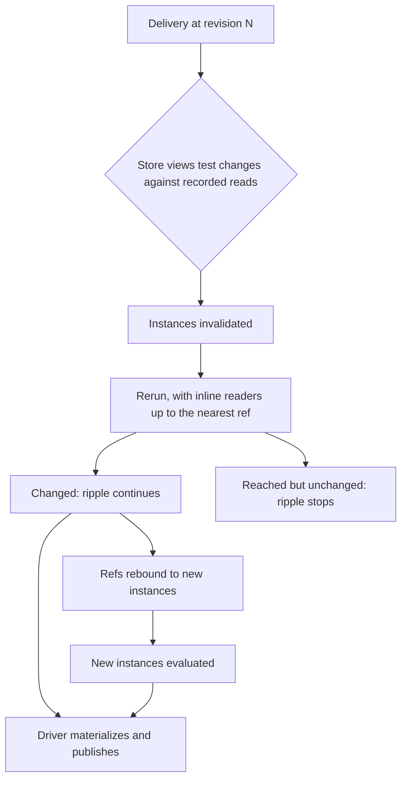
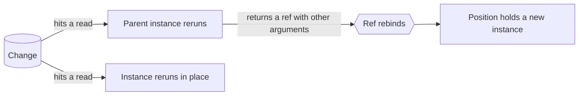

# Invalidation

See the [architecture overview](overview.md) for the broader system context,
[Views](views.md) for read tracking and ref boundaries,
[Stores and change feeds](stores.md) for how changes are delivered and matched,
and [Debugging](debugging.md) for how the records described here are presented.

Dependency tracking exists so that a change reruns exactly the views it reached.
That much is a performance concern. Refresher also commits to a stronger
property: every rerun is **explainable**, in both directions, and the
explanation is part of the contract.

| Question                     | Direction | Section                                            |
| ---------------------------- | --------- | -------------------------------------------------- |
| Why did this view rerun?     | Forward   | [The causal chain](#the-causal-chain)              |
| What did this change affect? | Reverse   | [Debugging](debugging.md#what-did-a-change-affect) |
| Why didn't this view rerun?  | Negative  | [Debugging](debugging.md#why-didnt-it-rerun)       |

All three read one relation: the intersection of what a view read with what a
change touched. Invalidation runs the same intersection, so an explanation and
the rerun it explains always agree.

## From a change to an update



A delivery carries every change of one atomic event at one revision. Each store
view tests the changes for its store against the reads recorded for it, and
answers which reads they hit. The instances that made those reads rerun in one
live-update pass. See [Execution](execution.md#live-update-pass).

## Matching a read

A recorded read holds three things a store view's matching test may use:

| Part      | What it says                        | Provided by                    |
| --------- | ----------------------------------- | ------------------------------ |
| Arguments | What the read asked for             | The reader                     |
| Revision  | Which changes the answer reflects   | The store view, or the default |
| Footprint | What the answer turned out to cover | The store view, optionally     |

Matching asks one question: could this change have altered what the read
returned? A wrong "yes" costs a rerun, which produces the same value and stops
the ripple. A wrong "no" leaves a stale result that nothing reports. Every rule
below leans toward "yes".

### Since when

A read's revision is the state its answer is: it reflects every change up to
that revision, and none after. Only changes after it are matched.

A store keeping history answers as of the revision it is asked at and reports
that revision. A store reading its current state reports that state's revision
when it knows it.

A store view that reports nothing gets the revision its execution started at.
That default is safe: a store answering from state older than the revision it is
asked at must report it, and its answer is then
[stale](consistency.md#stale-answers). It is a lower bound, so a change the
answer already reflected may still match, at the cost of one rerun. See
[Reading](stores.md#reading).

### Footprints

Arguments describe the request, and the request alone often can't tell whether
a change matters: what a read covers depends on the data it found. A footprint
records that. It is reported with the answer and handed to the matching test
next to the arguments.

Take the latest 40 messages of a room:

```js
// Pseudo-implementation: a window over the newest messages of a room.
const latestMessages = storeView({
  store: "messages",
  resolve: ({ roomId, limit }, { store, annotate }) => {
    const rows = store.newest(roomId, limit);
    const full = rows.length === limit;
    return annotate({
      data: rows,
      footprint: {
        oldest: full ? rows.at(-1).sentAt : null,
        ids: rows.map((row) => row.id),
      },
    });
  },
  matches: ({ roomId }, change, footprint) => {
    if (change.value?.roomId !== roomId && change.oldValue?.roomId !== roomId)
      return false;
    if (!footprint) return true;
    return (
      footprint.ids.includes(change.key) ||
      footprint.oldest === null ||
      change.value?.sentAt >= footprint.oldest
    );
  },
});
```

The arguments `{ roomId, limit: 40 }` alone match every change to the room,
including an edit to a message from last year. With the footprint, a change
matches when it:

- touches a message the window holds: an edit, a deletion, or a move away;
- lands at or after the window's oldest message: a new message enters;
- arrives while the window came back short: the window covers the whole room,
  so any new message in it enters.

Other reads where the answer decides what matters:

| Read                        | Footprint                               | Matching can then tell                                  |
| --------------------------- | --------------------------------------- | ------------------------------------------------------- |
| A cursor page               | The keys at both edges                  | A record landed on another page                         |
| The first match of a filter | The key it found                        | A new match sorts after it                              |
| A minimum or maximum        | The record holding it                   | A change to another record doesn't beat it              |
| A filtered list             | The keys returned                       | A record left, when the change reports only where it is |
| A request to a server       | The tags or version the server returned | A change the server says leaves it untouched            |

Footprints follow three rules:

- **Describe the answer as returned.** A footprint is a fact about the data
  the read found, never a restatement of the request. The window above came
  back short, so it covers the whole room, and its footprint says so. A
  footprint narrower than its answer misses changes silently.
- **Match conservatively.** A change missing what the test compares, such as
  one that reports a key without a value, matches. See
  [What a change reports](stores.md#what-a-change-reports).
- **Plain, immutable data.** A footprint lives as long as its read, is tested
  against every later change to its store, and may cross a boundary with the
  read. Keep it small: keys and bounds, never the records themselves.

A footprint and a revision describe the same answer: the footprint is a fact as
of the read's revision, and only later changes are tested against it.

A footprint never changes what a read answers; a rerun recomputes from the
arguments and the data. To keep an answer to a question that depends on when
it is asked, such as the newest chat, a [pin](pins.md) refers to a view that
gives it instead.

### Reads that are hard to match

Some reads cover data that no footprint bounds cheaply.

- **Aggregates.** A count, sum, or average over a filter changes whenever a
  record enters, leaves, or changes inside the filter, so its store view
  matches by the filter alone. A store that observes every change can keep
  the aggregate as an accumulator updated with each write, which makes the
  rerun cheap.
- **Logic on a server.** Ranking, recommendations, permissions, and joins on a
  server depend on data the client never sees. A server that follows the
  federation protocol pushes updates itself; see [Federation](federation.md).
  Any other server can return tags or a version as the footprint, and deliver
  changes that name the tags they touch.
- **Time.** "Messages from the last hour" changes as time passes. A view
  never reads the clock, since that makes its result depend on more than its
  inputs; see [Determinism](views.md#determinism). A read takes the time as an
  argument, or its footprint records the time it was answered at, and matching
  compares that with the timestamps changes carry. A result that expires with
  no change to deliver is future work.

## Two causes

A position in a result changes for exactly two reasons.

**Invalidation.** The same view instance reran, because a change hit one of its
reads. This is the terminal cause: it names a change.

**Rebinding.** The position now holds a different view instance. An instance is
a view plus its arguments, so an instance's arguments never change; what changed
is the ref its parent returned at that position. The cause of a rebinding is its
parent's cause, and the chain continues upward.



Views follow a reactivity model close to React components', and these are the
same two reasons a component re-renders. Invalidation is a state
or context update: the component's own inputs changed, so it re-renders itself.
Rebinding is a props update: the parent re-rendered and passed new props. React
DevTools answers "why did this render?" with the same two answers, "hooks
changed" or "props changed".

One difference follows from identity. React identifies a component by its
position in the tree, so new props re-render the same instance. Refresher
identifies an instance by its view and arguments, so new arguments lead to
another instance, and the previous one stays shared with any other parent that
still refers to it.

Two further causes end a chain without naming a change, and both are
exceptional:

- **Non-deterministic.** A view that declared itself non-deterministic may
  produce a different value from equal inputs. Its rerun is attributable to
  nothing else. See [Views](views.md#determinism).
- **Reset.** The live query restarted, so nothing before it is attributable,
  and the update says so with a reset reason. See
  [Lifecycles](lifecycles.md#live-queries).

Everything else ends in a change. That holds because views are side-effect-free
and read nothing but their arguments, store views, and other views.

## The causal chain

A reason is a chain of links. Each link names the next one, and a consumer
walks as far as it cares to:

```
room.messages[3].author
  ← rebound: `messageRow` at ["messages", 3],
             from `author@{ userId: "u1" }` to `author@{ userId: "u3" }`
  ← invalidated: `room@{ roomId: "r1" }` read `messages.byRoom` range { roomId: "r1" }
                 hit by revision 41 (operation "moveMessage")
```

Chains are reported whole, and a chain of length zero is valid. A chain
collapses to a flat reason for free, and a flat reason can't later grow a level
without breaking its consumers. The terminal link is also surfaced directly, so
a trace can connect a change to an affected view without walking.

A rebinding link costs nothing to keep: both sides are refs, which already carry
their arguments, so the difference between them is computed when asked.

### Causes beyond the change

A change carries an operation label of its store's choosing, and may carry the
source's own cause: the transaction that committed it, and what started that
transaction. Refresher carries these as given, so a chain can continue past the
change into the data source, and a trace can draw an arrow from a write to each
view it reached.

### Inlined reads

Reading a view inline fuses it into its caller: the two rerun together, and refs
remain the only update boundary. See [Views](views.md#refs-and-boundaries).

An instance's recorded reads include those of every view it read inline,
memoized or not, so it is validated by its own reads alone, whatever else is
still kept.

A memoized view read inline also keeps its reads under its own instance. When
its reads weren't hit, a session that still holds its value may reuse it and
skip running its `resolve`. This is permitted and never guaranteed, since values
may be gone. See [View caching](view-caching.md).

## What a hit names

The unit of attribution is the **read**. A store view answers with the reads a
change hit, so a change that touches fifty thousand records hits a range read
exactly once, described by the range that read covered. Attribution is bounded
by the recorded reads and adds nothing to what tracking already holds.

Within that bound, an explanation names:

- **Every hit read** of the instance. Invalidation may stop at the first hit,
  since it only needs a yes; an explanation needs all of them.
- **One witness change** per hit read: the first change that hit it, with its
  store, its key, and the fields that intersect what the read observed.

A store view answers both questions. Matching runs for every change; explaining
runs only for instances already known to be hit, so an unaffected view never
pays for it.

### Describing a read

A recorded read is compared, never parsed, so its description comes from the
store view that made it, in a small shared vocabulary that devtools and traces
can render for any store:

| Field    | Meaning                                                         |
| -------- | --------------------------------------------------------------- |
| `kind`   | `key`, `range`, `filter`, or `collection`                       |
| `fields` | The fields the read observed, when the store view tracks fields |
| `detail` | Store-specific, rendered as is                                  |

`collection` is the whole store as one read, which is what an aggregate such as
a count observes. `detail` keeps a store with unusual addressing describable
without widening the vocabulary.

## Precision

A reason is as precise as the change it names. The levels follow
[what a change reports](stores.md#what-a-change-reports):

| The change reports   | The reason names                                         |
| -------------------- | -------------------------------------------------------- |
| Its store            | The store and the reads it could affect                  |
| The key it touched   | The above, plus the record                               |
| Which fields changed | The above, plus the fields both the read and change have |

Refresher compares no values to make up the difference. A coarse answer is
already correct, and comparing would cost every change in proportion to the size
of the record. A store view that can't be finer says so: "this store can't tell"
and "nothing finer changed" are different answers, and the
[negative question](debugging.md#why-didnt-it-rerun) needs to tell them apart.

## Where the ripple stops

An invalidated instance reruns, and may produce the value it produced before: a
change that didn't matter to this reader, or a value restored. The ripple stops
there.

This **reached but unchanged** set is the most valuable record change
propagation produces. It separates "your view wasn't affected" from "your view
was affected and it made no difference", and it is the first thing to look at
when a view didn't update and should have. It is recorded in every case.

### Publication is the driver's decision

Whether an update that changes nothing reaches subscribers is up to the
[query driver](execution.md#query-drivers), which already decides what the
consumer's result is. It is given the previous and next results and the
reasons, and decides whether to publish.

The default is to skip it. A component bound through `useSyncExternalStore`
re-renders on every new result, so publishing an unchanged value spends a render
to say nothing.

Two rules keep this contained:

- **Skipping is never attribution.** A skipped update is still recorded in full,
  so "what did this change affect" has no holes.
- **One-shot queries have no updates.** The decision only applies to live ones.

## The other directions

The same records answer the reverse and negative questions. Grouping hits by
delivery gives what a change affected; intersecting a view's recorded reads with
a change that didn't hit them gives why it didn't rerun. Both are derived when
asked, and nothing extra is captured when a change arrives. See
[Debugging](debugging.md).

## What is guaranteed

For a subscribed live query:

1. **No unattributed update.** Every update other than a reset names, for each
   instance that reran, a chain ending in a change or in a non-determinism
   declaration.
2. **Precision matches the change.** A reason names what its change reports:
   the store, the record, the fields.
3. **Explanation and invalidation agree.** Both run the same store view over
   the same recorded reads, so a view never reruns for a reason the explanation
   fails to name.
4. **Recording is unconditional.** Publication decisions never change what is
   recorded, only who is told.
5. **Gaps are explicit.** A reset, a released live query, or a cause the source
   didn't provide is reported as such, never as an absent cause.
