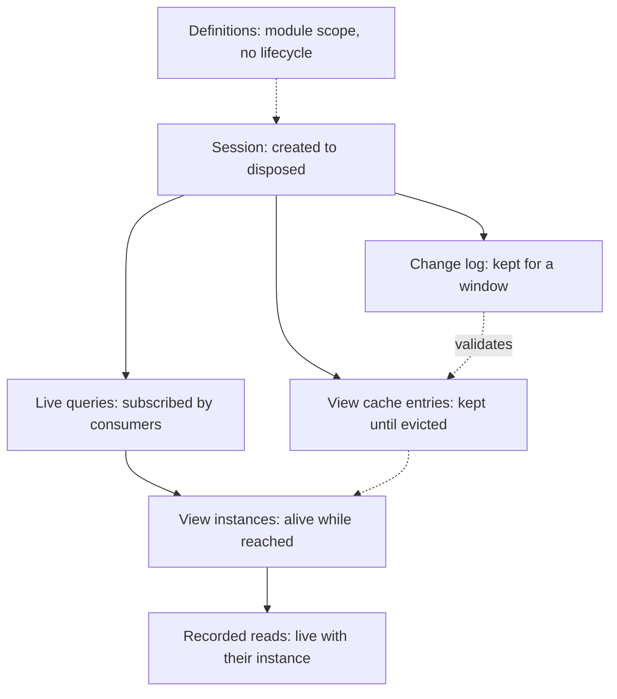
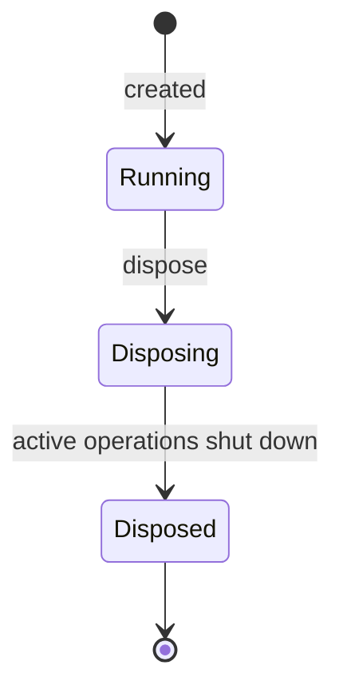
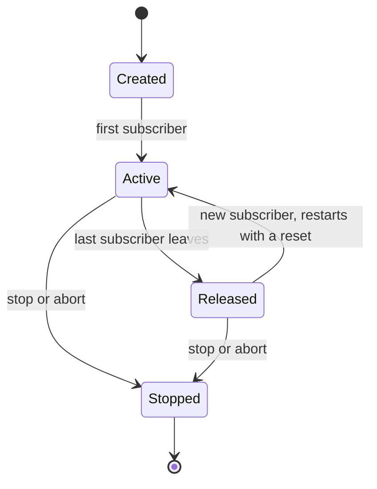
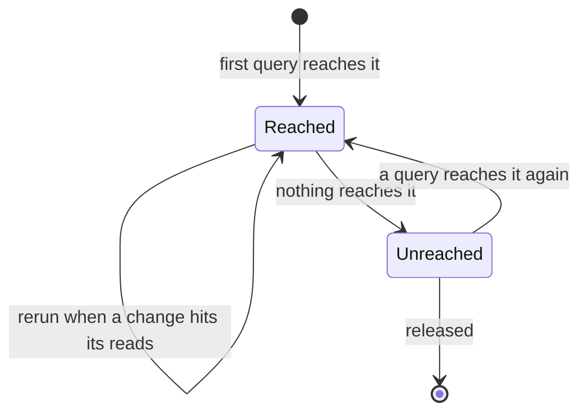

# Lifecycles

See the [architecture overview](overview.md) for the broader system context,
[Guarantees](guarantees.md#live-query-lifecycle) for the lifecycle contract, and
[Performance and memory](performance.md) for what each stage costs.

Several things in Refresher come and go: sessions, queries, live queries, view
instances, their recorded reads, and cached results. Only sessions and queries
have a lifecycle the application drives. Everything else lives exactly as long
as something reaches it.

## Controllers

> **Design in progress.** The shape of controllers is still open.

A session holds state and drives nothing on its own. Its **controllers** react
to signals from inside and outside the session, and handle the lifecycles of
what it holds:

- The **host** controller handles the session's own executions: live queries,
  including those other sessions ask for, the view instances they reach, cached
  results, and the change log. It decides what to do with an instance that
  [settled stale](consistency.md#stale-answers), such as asking the remotes
  controller for a fresh answer.
- The **remotes** controller coordinates with every other session this one
  reads from or answers: what each keeps live, when it lets go, and whether to
  answer with a [stale entry](view-caching.md#stale-entries) while the view runs
  again.

When each lets something go, such as an instance nothing reaches any more, is
its own policy.

## Compared to React

React components and Refresher views share a shape, and differ most in how
long things live. A fiber lives at a position in the tree; a view instance lives
while some query reaches it, wherever that happens.

| React                                                                                 | Refresher                                                                                                                  |
| ------------------------------------------------------------------------------------- | -------------------------------------------------------------------------------------------------------------------------- |
| A component definition lives in module scope                                          | A view definition lives in module scope                                                                                    |
| A root is created, rendered into, and unmounted                                       | A [session](#sessions) is created, runs operations, and is disposed                                                        |
| A fiber mounts when its position in the tree appears, and unmounts when it disappears | A [view instance](#view-instances) exists while any query reaches it, and is released when none does                       |
| One fiber per position: two `<Avatar name="Ada" />` elements are two fibers           | One instance per arguments: every `ref(avatar, "Ada")` in a session is the same instance                                   |
| State lives in the fiber, and is lost on unmount                                      | Views hold no state. Stores hold it, and a result is always recomputable                                                   |
| Effects run after mount and clean up on unmount                                       | Views have no effects, so a released instance has nothing to clean up                                                      |
| A component re-renders when its state, props, or context change                       | An instance reruns when a change hits one of its recorded reads                                                            |
| A component that remounts starts with fresh state                                     | A released live query restarts with a reset; [view caching](view-caching.md) may answer it without running the views again |

The consequence for a React developer: unmounting a component never tears down
data another component still shows. A component subscribes to a root, and the
instances under that root stay alive for as long as any subscribed root
reaches them.

## Sessions

A session starts when it is created, subscribes to its data source, and runs
operations until it is disposed.

- **Running.** The session accepts queries and live queries, and follows its
  data source's change feed. See [Stores and change feeds](stores.md).
- **Disposing.** The session rejects new work, aborts active operations, and
  waits for them to shut down cooperatively. Its live queries stop.
- **Disposed.** Operations against the session fail with a **session** error.
  See [Errors](errors.md). Results already delivered to consumers stay valid.

An application may run several sessions at once: one on the main thread and one
in a worker, for example, or a fresh one for each test, which keeps tests
isolated from each other without any cleanup.

Nothing a session derives outlives it. Revisions, recorded reads, and causality
belong to the session that produced them, so a live query in a new session —
after a reload, for example — starts with a reset. Anything that must survive a
reload, such as a synchronization cursor, belongs in a store. A
[persisted view cache](view-caching.md#persisted-caches) is the one exception,
and only while nothing changes between sessions.

## Queries

A one-shot query is created, runs one execution, and publishes one result.
Creating it starts no work. Once it completes, it keeps nothing: the instances it
reached are released unless a live query or the cache still holds them. An abort
signal ends it early, and since queries only read, there is nothing to undo.

## Live queries

A live query is a query that stays subscribed. Consumers drive it by subscribing
and unsubscribing, as components mount and unmount.

- **Created.** Creating a live query starts no work. Its first subscriber
  starts the first execution.
- **Active.** While at least one subscriber is attached, every instance the live
  query reaches is refreshed as changes arrive, and each refresh is published.
- **Released.** When the last subscriber leaves, the live query stops
  publishing and lets go of its instances and recorded reads. A later subscriber
  restarts it, and its first update is a reset. With
  [view caching](view-caching.md), instances whose reads no change has hit
  answer from the cache, so the restart reruns only what changed.
- **Stopped.** Stopping is final for that live query. It never stops another
  live query, even one that shares instances with it.

Each live query has its own lifecycle, including live queries started together
in one [batch](queries.md#batches), as components rendered in one React commit
unmount independently.

The latest state of a live query stays the same object until it publishes or
its lifecycle changes, so React can read it with `useSyncExternalStore`.

A [query driver](execution.md#query-drivers) decides when its consumers
subscribe and unsubscribe. A React driver, for example, may keep a root
subscribed for a moment after its last component unmounts, so a render React
discards, or a component that remounts at once, finds the root still active.

## View instances

A view instance has no lifecycle of its own. It exists while something reaches
it:

- an execution in progress;
- an active live query whose graph includes it;
- a cache entry, when [view caching](view-caching.md) keeps its result.

Since instances are [shared by arguments](views.md#what-a-view-is), several
live queries may reach one instance. Release is a question of reachability: a
live query that is released or stops lets go only of what no other live query
reaches. A component that unmounts takes nothing away from a sibling that still
shows the same data.

A view gets no notice when its instance is created or released, and needs none.
Its `resolve` is side-effect-free, so there is nothing to set up or clean up.
Subscriptions to data belong to the session, through its data source.

**Recorded reads** live and die with their instance, or with its cache entry.
They are what lets a live instance rerun when a change hits it, and what lets a
cache entry be validated when it is used again.

## Cached results

A cache entry stays while a [controller](#controllers) holds it. Once nothing
holds it, the session's eviction policy decides when it goes. Eviction is
invisible to results: an evicted entry is recomputed when it is needed again.
See [Lifetime](view-caching.md#lifetime). A stale entry stays too: an execution
never uses it, but the remotes controller may answer with it while the view runs
again. See [Stale entries](view-caching.md#stale-entries).

An unused entry costs no work as changes arrive. When it is needed again, it is
validated against the changes since, which the session keeps in its
**change log** for a recent window. An entry older than the window goes stale,
and is recomputed. See [Validation](view-caching.md#validation).

## Delivered results

A result delivered to a consumer is a plain value, independent of anything the
session keeps. It stays valid after its live query is released or stops, and
after the session is disposed. The consumer owns it, as
React owns the props it rendered.

## Across sessions

A session that reads views another session runs keeps them live through its
[remote store](federation.md#staying-live-across-sessions), coordinated by
its [remotes controller](#controllers): the answering
session pushes new answers while a live query here depends on them, and lets
them go once nothing does.

> **TODO.** How the two sessions coordinate this is part of the
> [protocol](federation.md#the-protocol), which is still to be designed.

## Memory at each stage

| Stage               | What the session holds                                       |
| ------------------- | ------------------------------------------------------------ |
| Active live query   | Its instances and their recorded reads                       |
| Released or stopped | Nothing, apart from instances other live queries still reach |
| Cached result       | The result and its recorded reads, until evicted             |
| Change log          | Changes delivered within its window                          |
| Completed one-shot  | Nothing, apart from cached results                           |
| Disposed session    | Nothing                                                      |

A live query keeps no results, only what each instance read; values are
recomputed when needed. Keeping values is [view caching](view-caching.md), and
is orthogonal to live queries. How the cache is evicted and how long changes
are logged is [configuration](configuration.md); what each stage costs is covered in
[Performance and memory](performance.md).
