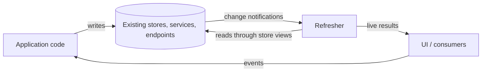
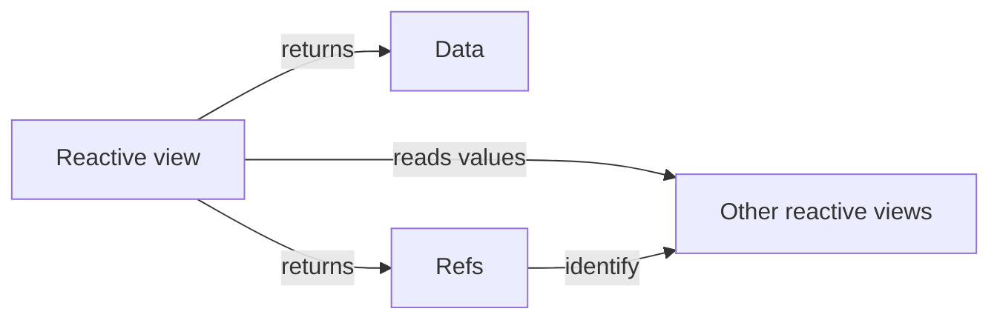
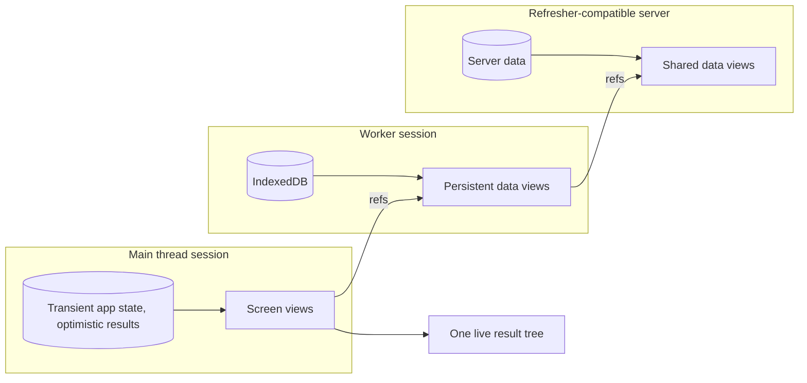
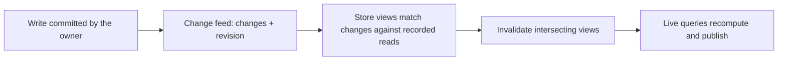
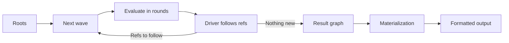
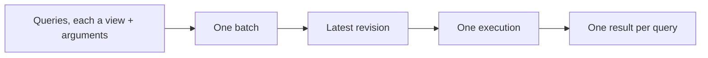
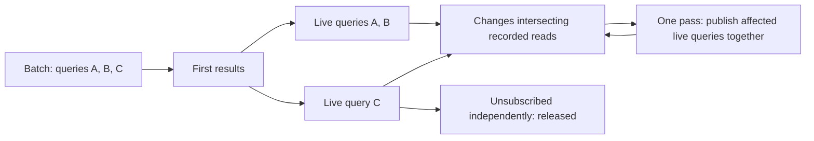
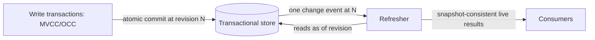

# Architecture overview

> This document is a high-level overview conveying key ideas behind Refresher,
> and leaving details for linked documents.

Refresher is a reactive data layer. It turns application data
into live, composable query results, keeps them up to date as the data changes,
and tells consumers exactly what changed and why.

Refresher works with the stores, services, and endpoints an application already
has. It needs only two things from a data source: a way to read it, and a
notification after it changes. Anything that can be observed this way — plain
in-memory state, IndexedDB, a REST or GraphQL endpoint, a server push channel —
can feed the same view graph, and several of them can feed it at once.



Writes stay where they are today: Refresher reads data, and the application
keeps full control over how it is written and synchronized.

Refresher is also designed to federate: one view graph can mix state that lives
in different places — the main thread, a worker, or a Refresher-compatible
server — and present it as one live result. See [Federation](#federation).

### Stronger guarantees with the transactional store

Refresher has a sibling component, the **transactional store**: a browser-first
store over memory and IndexedDB that commits writes atomically with MVCC/OCC,
and runs workflows that connect local state to external services. Together they
form a complete data layer, suitable for building application-specific sync
engines.

Refresher works on its own. Paired with the transactional store, it gains
additional consistency and concurrency guarantees — snapshot-consistent results
and atomic visibility of multi-store writes — with the same view code. These documents describe Refresher on its own and note those
additions where they apply. See
[Appendix: with the transactional store](#appendix-with-the-transactional-store)
and [Two-component architecture](two-components.md).

## Programming model

Refresher composes data much as React composes UI: developers define reusable
composable views and connect them into a graph. A view's arguments play the role
of component props, and its output is data.

This model is familiar to React developers, which makes Refresher a natural match
for React applications. Refresher itself is standalone, with no dependency on
React, so it works with any UI framework.

For developers familiar with GraphQL, Refresher execution resembles GraphQL
execution. Views act as enhanced resolvers: each one computes a piece of the
result from its arguments, and refs play the role of fields resolved by other
resolvers. Views also record exactly what they read and re-run on their own
when a store change intersects those reads, so results stay live.

The resemblance goes further: Refresher can run behind a GraphQL facade and act
as the reactive execution engine under it, mapping fields to views and returning results
in GraphQL shape (see [Execution](#execution)). The facade is optional: GraphQL
is one query driver among several, and Refresher works on its own without a
schema or GraphQL tooling.

Operations:

- A **query** evaluates one root view and follows the refs its consumer
  demands, either once or continuously as a **live query**. Queries started
  together run as one **batch**.

Everything else stays outside Refresher: writes, external effects, network
fetching, and synchronization belong to the application and its data sources —
or to the transactional store, when it is used. Views may describe the
application's actions as data, but never run them; see
[Actions as data](#actions-as-data).

## Data composition

Refresher data layers are composed from three primitives:

- A **store** holds raw data. It exposes its state through reactive **store
  views**, and reports its changes through a **change feed**. Refresher ships built-in stores and reference implementations
  of their backends, and applications can adapt their own storage the same way.
- A **reactive view** is a side-effect-free computation, like a React component.
  Store views expose store state; derived views read other views and return
  values and refs.
- A **ref** is a serializable reference to a view and its arguments, analogous to
  a React element. Refs create boundaries for reactive updates.

A view can consume another view in two ways, and choosing between them is the
main design decision in a Refresher data layer.

**Reading** a value inlines it: the callee's result becomes part of the
caller's result, and the caller depends on it, so whenever the callee's result
changes, the caller reruns as well. The dependency runs one way: a callee
recomputes only when its own inputs change, so when its caller reruns it may
answer from its cache, if [view caching](#view-caching) is enabled.

Returning a **ref** delegates it: the referenced view resolves separately,
and when its result changes it refreshes without rerunning its parent. Refs are
where you draw update boundaries, much as component boundaries decide what
re-renders in React.



### Example

Two stores, a store view, two derived views, and a ref:

```js
import { view } from "@graphitation/refresher";
import { objectStore } from "@graphitation/refresher/stores";

// Stores: Refresher reads them through store views such as `posts.record`.
const posts = objectStore({ name: "posts", primaryKeyPath: "id" });
const likes = objectStore({ name: "likes", primaryKeyPath: "postId" });

// A derived view, like a small React component.
const postLikes = view({
  resolve: (postId, { read }) => read(likes.record, postId),
});

// A parent view: reads the post inline and returns a ref to its likes.
const postWithLikes = view({
  resolve: async (postId, { read, ref }) => ({
    post: await read(posts.record, postId),
    likes: ref(postLikes, postId),
  }),
});
```

Think of `ref(postLikes, postId)` as `<PostLikes postId={postId} />` in
React, or as a field resolved by another resolver in GraphQL. A live query on
`postWithLikes` returns the post with its likes and keeps each of them up to
date separately. Because `postLikes` sits behind a ref, a new like updates
`postLikes` alone, without rerunning `postWithLikes`. The live query publishes
just that part of the result, so only the UI component showing the likes
re-renders: granular live query updates translate directly into granular UI
updates.

TypeScript types are omitted to focus on composition.

See [Views](views.md) for details.

## Guarantees

- **Granular updates:** A view is invalidated only by changes that actually
  intersect what it read. Unaffected views neither rerun nor republish.
- **Complete, ordered publication:** A live query publishes only complete
  results, and its results advance monotonically: each update reflects data at
  least as new as the one before.
- **Nothing missed:** A change that arrives while a result is being computed
  shows up in a later update. Live results converge to the latest data once
  changes stop.
- **Deterministic execution:** The same views over the same data produce the same
  result, the same refs, and the same update boundaries.
- **Type-safety:** Views, refs, and query results are statically typed with
  TypeScript. Runtime validation of view arguments and outputs is optional: a
  strict, schema-aware codec enforces it and reports invalid values as
  errors.

These guarantees hold over any data source that keeps the change-notification
contract. Paired with the transactional store, Refresher adds snapshot
consistency within one result and atomic visibility of multi-store writes. See
[Appendix: with the transactional store](#appendix-with-the-transactional-store).

See [Guarantees](guarantees.md) for the broader contract and its invariants.

## Environments and sessions

Refresher can run on the main thread, in a dedicated or shared worker, or on a
server. Running it in a worker keeps data work off the main thread; the model is
the same in every environment.

A **session** is one Refresher runtime instance. It owns execution,
subscriptions, and caches, while the data stays in its stores. A session is attached to one
change feed, and its sense of time follows the revisions that feed announces.

See [Sessions](session.md).

### Federation

> **Design in progress.** Federation is still being designed; this section describes its intent.

Application state rarely lives in one place. The main thread holds transient
app state — UI state, drafts, optimistic results of writes not yet confirmed —
a worker holds persistent data over IndexedDB, and a server holds shared data.
Refresher is designed to mix them in one view graph: each place runs its own
session over its own data, and a session can read views that another session
runs, receiving their results and updates as if they were local. This is
**federated execution**.



A view refers to another view with an ordinary ref, wherever that view runs.
Each source keeps its own revisions, and a federated result records the
revision of each source it reflects.

A server joins a federated graph by implementing a Refresher server
specification, which is yet to be defined.

See [Environments](environments.md) and [Federation](federation.md).

## Stores and change feeds

A store is anything Refresher can read through store views and hear about
through a change feed. The store's owner decides how data is written, where it
lives, and how it is synchronized; Refresher depends only on the read and notify
contract.

A **change feed** is how a store tells Refresher that its data changed. Each
notification reports a change that has already happened, and Refresher responds
by re-reading what it needs. Notifications carry a **revision** that only moves forward, and
the changes delivered together form one atomic event.



A **store view** reads store state and records what it read. When a change
arrives, the store view decides whether that change could affect a recorded
read. Matching must catch every relevant change, including one that would make
a previously missing record appear, and may conservatively over-match.

A store may answer a round's reads as one batch, for example in a single
transaction or request.

Refresher ships built-in stores, such as keyed object stores with indexes, along
with reference implementations of their backends. Applications can use them as
they are, back them with their own storage, or define store views of their own.

See [Stores and change feeds](stores.md).

## Schemas and values

> **Design in progress.** The codec's role and contract are still being designed and are likely to change.

A session chooses a **codec**, which gives view arguments a stable
identity and is reserved for optional runtime validation of view arguments and
results.

**By default, type-safety is static.** A session that chooses no codec uses
the default one, which is schemaless: it relies on
TypeScript to check view arguments and results, and views need no schemas to
start with.

**Runtime validation is opt-in.** A session that needs it — for example, one
answering requests from another session or a server it does not fully trust —
can choose a strict, schema-aware codec. Such a codec validates view arguments
and outputs against application schemas and reports invalid values as errors.
Views are written the same way under either codec.

**A schema is the codec's vocabulary.** A view may declare a schema: runtime
definitions of its arguments and result, paired with their TypeScript types.
Refresher passes the definitions to the codec and never reads them, so they can
be a validation library's schemas or the types of a GraphQL schema, when views
serve data behind a GraphQL API.

See [Codec](codec.md).

Views reference each other the way React components do: by importing them as
ES modules. A reference is an ordinary module edge that needs no registry or
resolution step, so bundlers can tree-shake views that nothing imports, just
like unused components. **Linking** covers refs encoded as data: an encoded ref
carries an id, and the receiving session resolves that id back to a view.

See [Linking](linking.md).

## Execution

Execution is the process of computing reactive views and the refs they return.
The consumer's **query driver** drives it: starting from the query's root, it
asks for a **wave** of views, then chooses the refs to follow into the next
wave, until it has nothing new to follow. Drivers are recommended to go
breadth-first, one wave per depth, because it batches best; the order is
theirs to decide. Execution spans these steps:

- **evaluation**: runs the views the driver asks for, batching their reads in
  rounds, and registers their dependencies
- **following refs**: the driver chooses the refs to follow next, from a query
  or schema known in advance, or by inspecting the values
- **materialization**: the driver converts the result graph produced by the
  previous steps into the consumer's output

The session takes no part in the process; it only supplies the stores, access
rules, codec, and linker that execution uses.



Within a wave, views run until each one is waiting only on reads. The reads
still pending form a **round**: each store receives the round's reads as one
batch, and the answers are delivered together, in the order the reads were
issued. A round's contents depend only on what views asked, so they are
deterministic. Rounds are how Refresher avoids N+1 reads: ten sibling views that
each read one record cost one batched read.

A view gets the most from rounds by issuing independent reads together:

```ts
// One round: both reads are known from the arguments.
const [post, likes] = await Promise.all([
  read(posts.record, postId),
  read(postLikes, postId),
]);

// A dependent read needs the previous answer, so it joins the next round.
const author = await read(users.record, post.value.authorId);
```

Every execution reads at one revision. All reads within it are tagged with that
revision, so a store that keeps history can answer them all as of the same
point in time.

This separation of steps makes federated execution possible and lets different
**query drivers** drive the same process, including a GraphQL executor and the
React reconciler.

Developers familiar with GraphQL will recognize the shape: the consumer's demand
plays the role of a selection set, and views play the role of resolvers. The
traversal differs — the GraphQL reference executor resolves fields depth-first
and leaves batching to tools like DataLoader, while Refresher batches reads in
rounds as part of execution itself.

See [Execution](execution.md) for the full process, the comparison with GraphQL
execution, and query drivers.

## Operations

### Query

A query evaluates one **root** — a reactive view with its arguments — and
returns its result. A screen rarely needs a single tree: a header, a sidebar,
and a message list are independent queries, yet they should load together and
agree with each other.

Queries started in the same round run as one **batch**, in one execution. They
share rounds, so their reads are batched together, and they read at the same
revision, so their results are consistent with each other. Each batch runs as a
fresh execution at the latest revision.

How deep the query goes is decided by its **query driver**, which governs
which refs are followed and what representation the consumer receives.
See [Execution](execution.md) for details.



### Live query

A live query starts as an ordinary query and then stays subscribed. Changes that
arrive while the first result is being computed schedule another pass, and the
subscriber sees their effect as its next update.

Each live query has its own lifecycle, so it can be unsubscribed — for
example, when its component unmounts — while the others keep running. This mirrors React, where components
rendered in the same commit unmount independently.

Live queries keep sharing execution after they start. A change that affects
several of them is processed in one pass at one revision, and their updates are
published together, so every result a consumer sees reflects the same changes.
Live queries a change does not affect are left untouched.

Every published update carries the new values and causality metadata, so a
consumer can tell what changed, which views changed it, and which store changes
caused it.

While a live query has at least one subscriber, its invalidated views are
refreshed automatically. When its last subscriber goes away, it is released,
along with views and dependencies not shared with another live query. See
[Lifecycles](lifecycles.md) for how this compares to React component lifecycles.



See [Queries](queries.md).

## Actions as data

> **Design in progress.** Actions as data are still being designed; this section describes their intent.

Views can describe what a UI may do with their data, not only the data itself.
A view returns `action(likeMessage, args)` next to its values, and the UI runs
any action ref it receives through one interface of the application's own,
such as `run(item.like)`:

```js
const messageItem = view({
  resolve: async (messageId, { read, action }) => ({
    body: (await read(messages.record, messageId)).value.body,
    like: action(likeMessage, { messageId }),
  }),
});
```

An action ref is a typed address, never evaluated: Refresher builds, carries,
and encodes it, and the application's runner runs it, locally, to a
worker, or to a server. Since it is part of a view's value, a live query keeps
it current: a view offers an action where the data allows it and leaves it out
where it does not.

Input only the consumer has, such as the text of a new message, is an
[input](variables.md) the view leaves open in the ref's arguments:
`action(sendMessage, { chatId, text: input("text") })`. The runner
binds it with the UI's value, and a query driver binds open inputs in view
refs the same way.

See [Actions](actions.md) and [Variables](variables.md).

## Data consistency

Queries are often complex operations involving many concurrent (async) reads. A
naive data layer leaves room for race conditions and subtle bugs: a result
assembled from reads taken at different moments, or an update that silently
replaces newer data with older data.

Refresher is designed to prevent this class of issues within the guarantees its
stores can support:

- Every execution reads at one revision, and its results are published in
  revision order, so a live result only moves forward.
- Over a store that keeps history, all reads in one execution see the same
  point in time, and the result is a consistent snapshot.
- Over a store that holds only current state, an individual result may combine
  reads taken a moment apart, but every change that could affect it schedules a
  recompute, so live results converge to the latest data.
- A federated result records the revision of each source it reflects; each
  source is consistent on its own.

These guarantees also depend on the application keeping its side of the
contract: notify after a change is committed, report changes from every writer,
and treat values Refresher has returned as immutable.

See [Consistency](consistency.md).

## Invalidation

Refresher tracks dependencies automatically. For each view instance it records
only what invalidation needs: the instance's arguments, the reads it made, and
the footprint each read's answer reported, such as the far edge of a page. These
records alone are enough to detect when a result is stale.

A store change invalidates only the views whose recorded reads it intersects. A
view in the middle of a result tree may refresh while its parent and children
stay untouched — the effect React gets from `memo` boundaries, here derived from
tracked reads.

See [Invalidation](invalidation.md) for how reads are matched and how every
rerun is explained.

## View caching

Keeping view results in memory is a separate, optional concern. With view
caching enabled, a view whose inputs are unchanged answers from its cache — for
example, when a caller reruns or a component mounts a root again. With caching
disabled, invalidation is equally precise, and a view is recomputed when its
result is needed again. The application decides what is cached and how it is evicted.

Invalidation is built in. The session keeps recent changes in a **change log**,
and when a cached result is needed again, it matches the changes since against
the result's tracked reads, the same way it matches a live one. The application
writes no invalidation or refetch logic, and an unused result costs no work as
changes arrive. Over stores whose change feeds report every change, a cached
result is always current.

See [View caching](view-caching.md).

## Error handling

> **Design in progress.** Error handling, including fallbacks, is still being designed and may change.

Errors in Refresher are data. Each one has a kind from a closed set that says
where it came from: a store, a view, a ref, a value, the session, the operation,
or Refresher itself.

Where an error stops depends on how a view was consumed:

- An inline **read** fails its reader, just as a thrown error fails the
  function that called it. The failure travels up through inline reads until it
  reaches a view with a fallback, or the nearest ref.
- A **ref** is an error boundary: a failure stops there. A failed referenced
  view resolves to `null` plus an error carrying the path to where it
  failed; its parent and siblings are unaffected.
- Failures of the operation itself, such as an unknown view or a closed session,
  reject the operation.

A view can define a **fallback** — an error representation of its own result,
much like a React error boundary renders fallback UI. A fallback returns the
view's own result type, so a ref to an imported view with a fallback always
resolves to a value. The error is still reported, and the view recovers when a later change
lets it succeed.

How a contained failure is presented — a `null` with a collected error, a
GraphQL `errors` entry, or an error thrown to a React error boundary — is up to
the query driver.

A live query whose pass is rejected keeps its last good result and reports the
failure alongside it, so consumers keep the data they already displayed.

See [Errors](errors.md).

## Debugging, tracing and observability

Reactive applications are notoriously hard to debug: an update arrives, and it is
rarely obvious which change caused it or which views reran. Harder still is the
opposite case — a view that _didn't_ rerun when you expected it to. Nothing
happens, there is no event to inspect, and the bug looks like stale data with no
trail leading back to a cause. Refresher is designed to make both cases
traceable.

Because dependencies are recorded exactly, a non-update is as explainable as an
update: Refresher can show what a view actually read and why a given change did
not intersect it. Every update carries the store changes that caused it, and
Refresher can emit a synthetic [Perfetto](https://perfetto.dev) trace reflecting
application activity — operations, execution steps, invalidations, and the
changes that caused them — so a whole session can be inspected on one timeline.

See [Debugging](debugging.md).

## Testing

Most of Refresher's guarantees hold only if application code keeps its side of
the bargain: views are side-effect-free and deterministic, store views catch every
relevant change, and change feeds report every write after it commits. A
violation usually surfaces later and far from its cause: as a stale result, a
missing rerun, or a bug that reproduces once in a thousand runs.

Refresher therefore ships contract checkers and other testing tools that assert
user code adheres to its expectations, turning those latent violations into
ordinary test failures at the point where they are introduced.

See [Testing](testing.md).

## Performance and memory

Store views and views are application code, and they decide how efficient a
reactive application is. Refresher reruns exactly what matching reports and
adds nothing finer, so a store view that matches every change, or a view that
reads a whole store to use a few records, reruns on every change to that store.
Refresher supplies reference store views, guardrails, contract checkers,
traces, and explanations of every rerun; an efficient application still takes
discipline in how its store views match and how its views read.

Refresher is built with performance and memory management in mind and gives
applications several ways to control both: batched reads, which view results
are cached and how they are evicted, and resource limits. Those tools and the trade-offs between them are described in
[Performance and memory](performance.md).

## Document map

| Document                                        | Contents                                                                             |
| ----------------------------------------------- | ------------------------------------------------------------------------------------ |
| [Guarantees](guarantees.md)                     | The full contract Refresher upholds and the invariants behind it                     |
| [Sessions](session.md)                          | The runtime instance that owns execution, subscriptions, and caches                  |
| [Stores and change feeds](stores.md)            | Store views, change feeds, revisions, and matching changes against reads             |
| [Views](views.md)                               | Reactive views, refs as update boundaries, and read tracking                         |
| [Codec](codec.md)                               | Argument identity and optional runtime validation                                    |
| [Linking](linking.md)                           | View ids, and resolving the ids that encoded refs carry                              |
| [Actions](actions.md)                           | Action refs: actions described as data and run by the application                    |
| [Variables](variables.md)                       | Inputs a ref leaves open, and the variables that bind them                           |
| [Execution](execution.md)                       | Evaluation, following refs, materialization, waves, rounds, and query drivers        |
| [Queries](queries.md)                           | One-shot and live queries: batches, subscription, publication, and release           |
| [Pins](pins.md)                                 | Answers kept as of the query reaching them: the newest chat, a stable page           |
| [Pagination](pagination.md)                     | Pages as pinned key ranges: how they form, stay live, and stay stable                |
| [Lifecycles](lifecycles.md)                     | Sessions, live queries, view instances, and cached results, compared to React        |
| [Consistency](consistency.md)                   | Revisions, snapshots, convergence, and the application's side of the contract        |
| [Invalidation](invalidation.md)                 | Dependency tracking and invalidation                                                 |
| [View caching](view-caching.md)                 | Optional caching of view results, its lifetime, and its limits                       |
| [Errors](errors.md)                             | Error kinds, ref boundaries, fallbacks, nullability, and presentation                |
| [Debugging](debugging.md)                       | Causality metadata, Perfetto tracing, and debugging tools                            |
| [Testing](testing.md)                           | Contract checkers and testing tools for user code                                    |
| [Configuration](configuration.md)               | Resource limits and other settings a session applies                                 |
| [Performance and memory](performance.md)        | Controls, budgets, and trade-offs                                                    |
| [Environments](environments.md)                 | Main-thread, worker, and server deployment                                           |
| [Federation](federation.md)                     | Sessions reading views other sessions run, and the protocol between them             |
| [Two-component architecture](two-components.md) | How Refresher and the transactional store interact, and what they guarantee together |

## Appendix: with the transactional store

Refresher's core guarantees assume nothing about how a data source handles
concurrent writes. A source that does more lets Refresher promise more.

The transactional store keeps enough history to answer a read as of a given
revision (MVCC), and commits writes atomically, rejecting conflicting ones
(OCC). Paired with it, Refresher adds:

- **Snapshot consistency:** A query publishes one complete, tearing-free result
  read at one revision. Changes committed while it runs arrive later as live
  updates.
- **Atomic visibility:** A write that spans several stores is committed as one
  revision and delivered as one change event, so every result reflects it
  entirely or not at all.
- **Read-your-writes through views:** A write transaction can evaluate views
  against its own uncommitted state, using the same view definitions the UI
  reads.

Views are written the same way in both setups. The same view graph runs over
existing stores and services or over the transactional store; only the strength
of the consistency guarantee differs. Any other store offering the same
versioned-read and atomic-commit semantics gets the same guarantees.



See [Two-component architecture](two-components.md).
