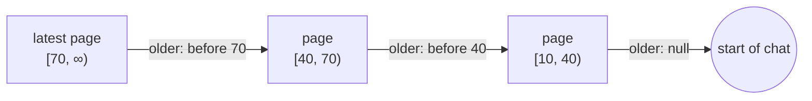

# Pagination

See the [architecture overview](overview.md) for the broader system context,
[Invalidation](invalidation.md) for matching changes against reads,
[View caching](view-caching.md#the-change-log) for the change log, and
[Consistency](consistency.md) for revisions.

This document shows how Refresher keeps a paginated list live while the data
under it changes.

The running example is a chat read newest first, three messages per page, with
each message keyed by its send time.

## The challenges

Reading a page once is easy. Keeping loaded pages current while messages arrive,
change and disappear raises problems a one-off read never meets:

1. **Pages shift.** A page defined by position, such as "messages 4 to 6",
   changes whenever a message lands before it. Every loaded page moves, and rows
   jump from page to page.
2. **Older pages have to line up.** Loading further back must not repeat or skip
   a message, even when send times tie.
3. **Messages arrive while a page loads.** A message sent between reading a page
   and subscribing to it must not be lost.
4. **Messages enter, leave and move.** A change must reach the page it lands in,
   and a message moving between pages must never show on both or on neither.
5. **Live pages cost work.** A change must cost work in proportion to what it
   touches, not to how much is loaded.

The sections below answer them in order.

## 1. Pages are ranges, not counts

A page is not "the next 3 messages". It is **every message whose key falls in a
range**, `[from, to)`, and it holds whatever lies in that range. Refresher has
no pagination primitive: a page is an ordinary view over a range, kept live like
any other.

```text
key      10  20  30 │ 40  50  60 │ 70  80  90
page     [10, 40)   │ [40, 70)   │ [70, ∞)
         oldest     │            │ latest, open-ended
```

Consecutive pages share a boundary: the `from` of one is the `to` of the page
before it. Ranges are half-open, so every key falls in exactly one page, and a
record whose key equals a boundary always falls on the newer side. The latest
page has no upper bound, so new messages join it.



Counted pages shift every loaded page on each insert. Range pages change only
the page the record lands in:

```text
insert 95             counted pages                    range pages
before                [10 20 30] [40 50 60] [70 80 90] [10 20 30] [40 50 60] [70 80 90]
after                 [20 30 40] [50 60 70] [80 90 95] [10 20 30] [40 50 60] [70 80 90 95]
pages changed         3 of 3                           1 of 3
```

## 2. Count once, keep the range

A range needs bounds, and only counting finds them. The count has to run once,
and its answer has to be kept: the range is frozen.

Freezing a range takes a lookup with two properties:

- **It answers with a range, not contents.** The lookup counts back from a
  boundary and answers with a reference to the page over the range it found.
  The page reads its own contents.
- **Its answer is kept per query.** Once the lookup has answered, the query
  holds on to that range, and the lookup's reads are no longer subscribed. No
  later change makes it count again.

In Refresher, this lookup is a [pin](pins.md).

The price of frozen ranges is that page sizes drift. The latest page grows
while the query stays open, and deletions shrink pages, possibly to empty. A
page that grows too large can be replaced by running the lookup again in a new
query, or split in two.

## 3. Older pages line up

Frozen ranges bring three benefits:

- **No overlap.** Two ranges that share a boundary hold no key in common.
- **No gap.** Every key below the latest page's `from` lies in the range of
  whichever older page covers it once opened.
- **No duplicate under ties.** Boundaries are keys, not positions. Every record
  whose key equals a boundary falls on its newer side, and the lookup counting
  back from a boundary reads strictly before it.

A lookup run again may find another range: the frozen range belongs to the
query, and a new query looks up afresh. A consumer that closes a page and opens
it again later keeps the chain whole by asking for every older page from the
boundaries the reopened pages answer, rather than from boundaries it remembered.

## 4. Entering, leaving and moving

New messages land in the latest page, whose range is open-ended, so it grows. A
late message grows the older page its key falls in, and a deletion shrinks the
page the message was on, possibly to empty. Boundaries never move, so a page
never hands a message over to its neighbour.

```text
                    [10, 40)    [40, 70)       [70, ∞)
start               10 20 30    40 50 60       70 80 90
+ m95               10 20 30    40 50 60       70 80 90 95    latest page grows
+ m55, sent late    10 20 30    40 50 55 60    70 80 90 95    older page grows
− m80               10 20 30    40 50 55 60    70 90 95       latest page shrinks
```

A record that moves between pages is one change with an old and a new value,
delivered in one event. Its old key hits the page it leaves, its new key the
page it joins, and both rerun in the same pass at the same revision and publish
together. No consumer sees the record on both pages or on neither.

## 5. Work in proportion to the change

The work a delivery costs is proportional to what it touches, not to how much
is loaded.

A page holds refs to its messages, not the messages themselves, and each
message is a view of its own. A live query publishes only the parts of its
result that changed. When a new message arrives, the latest page reruns and its
list of refs is sent again, but only the new message's view is evaluated and
sent; the views of older messages are not.

In JSON:

1. The initial query sends the first page, with two messages:

```json5
// list sent:
[
  "ChatMessage(id:'m1')",
  "ChatMessage(id:'m2')",
]
// items sent:
[
  { id: "m1", text: "hello", createdAt: 10 },
  { id: "m2", text: "world", createdAt: 20 },
]
```

2. When a new message arrives, only the list and the new item are evaluated
   and sent:

```json5
// list sent:
[
  "ChatMessage(id:'m1')",
  "ChatMessage(id:'m2')",
  "ChatMessage(id:'m3')",
]
// items sent:
[
  { id: "m3", text: "new", createdAt: 30 },
]
```
