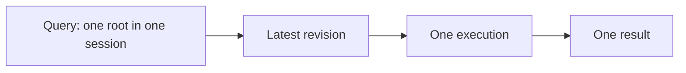

# Queries

> **Work in progress.** The query contract is being redesigned together with
> [Federation](federation.md); this document will change.

See the [architecture overview](overview.md) for the broader system context,
[Execution](execution.md) for the process a query drives, and
[Lifecycles](lifecycles.md) for how queries and live queries come and go.

A **query** runs one **root** view with given arguments against one session,
under the [query driver](execution.md#query-drivers) that asked for it. A query
may also run a [ref](views.md#refs-and-boundaries), which encodes a view and its
arguments in one value. Running a query
is one execution at the latest revision, and the query returns one result.
Queries started together run as one [batch](#batches), which shares execution
and reads at one revision.

A query may also carry values for the [inputs](variables.md#queries) views leave
open in their refs, and variables its driver maps onto them, as a GraphQL
operation does.

A query belongs to its session from the moment it is created. Creating a query
starts no work.



A result holds the root's value, the errors found along the way, and the
revision the execution read at. A root whose view failed holds its
[fallback](errors.md#fallbacks) result, or `null` when it has none, and the
failure is in the result's errors either way. See [Errors](errors.md).

Every read of the execution carries the same revision, so a result is never
assembled from two moments of a source that keeps history. Changes committed
while a query runs are simply later; they don't affect its result. How this
holds per source is described in [Consistency](consistency.md).

A one-shot query keeps nothing once it completes. Each run is a fresh
execution. See [View caching](view-caching.md) for results a session may keep
between runs.

## Live queries

A live query is an ordinary query that stays subscribed. Its first run is the
same execution a one-shot query performs; the live query then keeps the reads
each view instance recorded, and the session reruns the instances a change
intersects. See [Invalidation](invalidation.md).

A live query's timeline begins at the revision its first execution read at.
Changes committed while that execution runs arrive as its next update, so a
consumer never misses a change between the first result and the moment it
subscribed.

Each update is a complete result, carrying:

- the revision it reflects;
- its **causality**: the store changes that caused it and the views they
  invalidated;
- whether it is a **reset**: the first result, or the first after the live query
  restarted.

A consumer reads the latest update directly, or iterates updates in order. A
slow iterator may skip intermediate updates, and always receives the latest
one; updates never arrive out of order.

When a rerun fails, the live query keeps its last good result and reports the
failure alongside it, so a consumer can go on showing data it already has.

### Lifecycle

A live query is active while it has subscribers, and released when the last
one leaves; stopping it is final. It keeps no
results, only what each view instance read. See
[Lifecycles](lifecycles.md#live-queries).

## Batches

Queries started in the same round run as one **batch**: one execution, whose
queries share rounds, so their reads to each store go out together. Components
that each start a query in one React commit cost about the same as a single
query over all their roots.

A batch reads one snapshot. Every query in it reads each source at the same
revision:

- **A source that keeps history** is read at a revision the batch pins.
- **A source without history** answers the whole batch from its current state,
  in one execution.

Across sessions, a remote store sends a batch's queries together, with the
revision to read at when the answering session keeps history; otherwise the
answering session runs the batch as one execution at its current revision.
See [Batching](federation.md#batching).

Each query in a batch keeps its own result and its own lifecycle, so one can
stop while the others keep running, as components rendered in one React commit
unmount independently. When results appear is the consumer's choice: a
consumer that reveals several queries together waits for all of them, as a
Suspense boundary does.

Live queries keep sharing execution after they start. A change that affects
several of them is processed in one pass at one revision, and the pass
publishes all their updates together once it completes, so every result a
consumer sees reflects the same changes.

## Sharing and release

View instances are identified by their definition and their arguments' identity
in the session, so live queries that reach the same instance share one
evaluation and one set of recorded reads. They share it under different drivers
too, because [drivers are invisible to views](execution.md#query-drivers).

Sharing makes release a question of reachability: a live query lets go only
of what no other live query reaches. See
[View instances](lifecycles.md#view-instances).

## Pins

A ref may lead to a [pin](pins.md), which answers with a ref to its target, a
view that gives its answer without depending on when it is asked. A query that
reaches a pin keeps that answer and continues from the target, which runs in
the same wave. Keeping is the runtime's: it hands each driver an `execute`
bound to the query, so drivers know nothing about pins. See
[Rules](pins.md#rules).

## Cancellation

A query or live query created with an abort signal stops when the signal aborts.
Aborting prevents further publication; what was already published stays valid.
Queries only read, so there is nothing to undo.

## Discussion and ideas

### Data masking

A query should give access only to the refs it followed. A ref it left out can
be passed on, or start a query of its own, and reading it is impossible. In the
spirit of Relay's fragment masking, with plain structural types, an external
ref carries what its query followed:
[Followed refs](federation.md#followed-refs).

`Followed` is a union of result types, so it works for any query driver, however
the query says how far it goes: by tags, by selections, or by the driver's own
choice. The external view declares it, and its answer carries it down:

```ts
type RoomFollowed = ResultOf<typeof data.message | typeof data.profile>;

export const messageRowView = view({
  resolve: (
    {
      messageRef,
    }: { messageRef: ExternalRefFor<typeof data.message, RoomFollowed> },
    { read, ref },
  ) => {
    // ...
  },
});
```

Structural subtyping does the checking. A ref from a query that followed more
fits where less is required, and a parent whose query leaves out what its child
needs fails to compile at `ref(messageRowView, { messageRef })`, exactly where
the query falls short.

**The runtime can enforce the same.** An external ref is a string or a number,
so what its query followed lives only in its type. The runtime enforces it as
far as the store goes: reading a ref whose instance it does not hold fails.

Open concerns:

- `Followed` is flat: a ref followed in one place counts as followed everywhere
  its result type appears in the answer. A per-position selection type, mapping
  each ref field, would be exact, at the cost of deep mapped types, which can
  slow down type checking, and self-referencing selections for recursive views.
- Views with the same result type are not told apart, since refs carry results
  and not arguments.
- `Followed` is declared next to the external view, by hand, and nothing checks
  it against how far the query goes.
- Refs can be global, readable whichever query brought their instance, or bound
  to the query that brought them, so a view reads only what its own query
  visited. Both are to be explored by adjusting materialization.

### Defer and stream

Defer and stream, as in GraphQL, change when parts of a result are published.
What runs stays the same, so they belong to the driver's sub-steps of
[execution](execution.md#query-drivers): demand and materialization. Evaluation,
rounds and the result graph are untouched.

- **Defer** marks a subtree as low priority. The driver follows its
  refs in a later wave, and materializes and publishes the result without
  waiting for them.
- **Stream** does the same for a list: the driver follows its first items, then
  the rest in later waves, and publishes after each.

Each publication is an update of the same query, at the same revision. Pending
parts are marked in the result, and the last publication is the complete
result.

```ts
const roomSelection = select<typeof data.room>()({
  messages: stream({ each: messageRowSelection }, { initial: 20 }),
  members: defer({ each: memberSelection }),
});
```

In React, a deferred part maps to a nested Suspense boundary. Colocated
components can get the same effect with a query each; one query with defer
keeps one snapshot and one round trip for the whole tree.

Open concerns:

- **One snapshot.** Deferred waves must read at the revision of the first
  publication. A source with history is read at the pinned revision; a source
  without one either answers all waves in one execution, which delays nothing,
  or the deferred parts read a later revision and the result says so.
- **Live queries.** A change that arrives while deferred parts are pending is
  processed by the next pass, which also completes them.
- **Federation.** Remote answers already stream per instance, so the remote
  store needs only the priority, to order its rounds.
- **Types.** With [data masking](#data-masking), a deferred field is typed as
  possibly pending.
