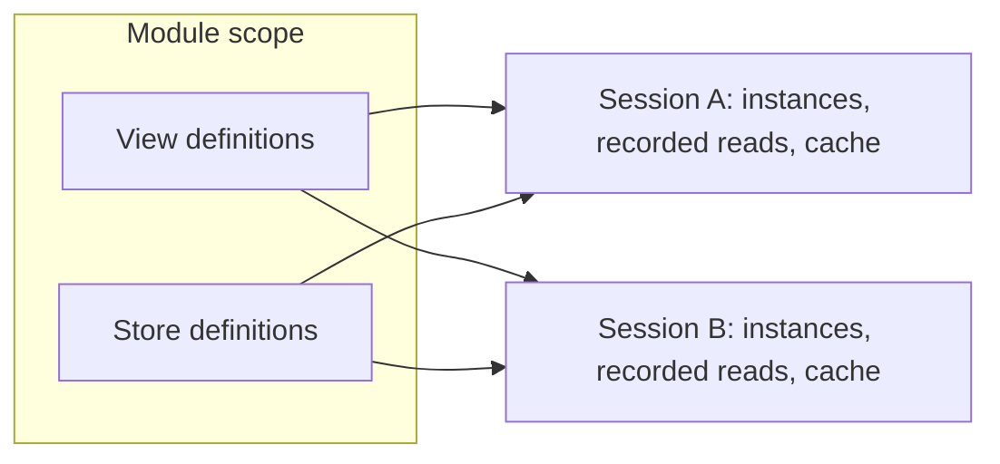

# Sessions

See the [architecture overview](overview.md) for the broader system context, and
[Guarantees](guarantees.md#guarantees-within-a-session) for what this boundary
promises.

A **session** is one Refresher runtime instance. It owns subscriptions,
recorded reads, cached results, and a log of recent changes. It runs nothing
itself: [query drivers](execution.md#query-drivers) run executions with what it
lends them, its clock, codec, stores and cache. The data itself stays in its
stores, under the control of their owner.

## Definitions and sessions

Definitions are not session state. A store or a view is a declaration in module
scope, and the same declaration used in two sessions describes two independent
things: each session has its own view instances, its own recorded reads, and its
own cache. Definitions need no registry, and nothing about a session is hidden in
a definition.

Every operation names the session it runs in. A session learns about views as
operations reach them, so what it holds is exactly what it was asked for. The
only views a session lists up front are the ones it publishes for encoded refs;
see [Linking](linking.md).

This mirrors React, where a component definition can render in several roots and
each root keeps its own state.

## What a session is given

A session is created with everything it needs to run views:

- **A data source.** A handle the session subscribes to for change
  notifications and lends to store views for their reads. A session needs one
  only when a query reaches a store view; a graph of pure derived views runs
  without one. See [Stores and change feeds](stores.md).
- **Other sessions.** Views this session links to but another session runs, for
  [federated execution](federation.md). Their results and updates arrive as if
  they were local.
- **A codec.** How the session identifies view instances, by ids for views and
  keys for their arguments, and, optionally, validates values. Drivers use the
  same codec, from the session, to find refs in results. See
  [Codec](codec.md).
- **A linker,** optionally. It maps the view ids in encoded refs back to views,
  for sessions whose refs cross as data, as in [federation](federation.md). See
  [Linking](linking.md#linking-ids).
- **Policies.** How long results stay cached, how long changes stay logged, and
  resource limits. See [Configuration](configuration.md).

A session holds the state it derives from these: view instances, the reads they
recorded, cached results when [view caching](view-caching.md) keeps them, and
live-query subscriptions.

## Time in a session

A session's sense of time follows the revisions its data source announces. Each
execution reads at the latest revision the session has seen, and each change
notification moves that revision forward and drives a live-update pass. See
[Consistency](consistency.md).

A session federated with other sessions sees their revisions as well. Each source
keeps its own revisions, and a federated result records the revision of each
source it reflects.

## Lifecycle

A session starts when it is created and lends what executions need until it is
disposed. Disposing it stops the executions running in it.
An application may run several at once, such as one on the main thread and one
in a worker. Nothing a session derives outlives it, so a live query in a new
session starts with a reset. See [Lifecycles](lifecycles.md#sessions).

## With the transactional store

A Refresher session reads stores that are already up. Bringing stores up —
loading persisted records, deciding which storage holds each store — is the
store owner's concern. The transactional store handles it for its own stores,
and a Refresher session attaches to its change feed like any other data source.
See [Two-component architecture](two-components.md).
