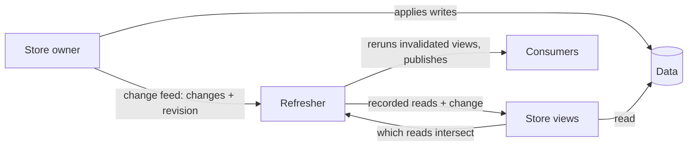

# Stores and change feeds

See the [architecture overview](overview.md) for the broader system context,
[Views](views.md) for the computations that read a store, and
[Consistency](consistency.md) for how revisions relate reads to changes.

A **store** is any source of data that Refresher can read from and that tells
Refresher when its data changes: plain in-memory state, IndexedDB, a REST or
GraphQL endpoint, a server push channel. Two pieces connect a store to
Refresher: **store views**, small views that read from the store, and a
**change feed**, which announces the store's changes.

The store's owner decides how data is written, where it lives, and how it is
synchronized. Refresher depends only on reading the data and hearing about
changes.

Declaring a store in Refresher allocates no storage. A store declaration is a
name that binds store views and changes to data someone else owns.

## Division of labour

Three parties share the work, and each knows only what it needs:

- **The store owner** holds the data, applies writes, and announces what changed
  through a **change feed**.
- **Store views** read the store, record what each read observed, and decide
  whether a change could affect a recorded read.
- **Refresher** keeps the recorded reads, hands each change to the store views
  of the store it touched, invalidates the views whose reads it intersects, and
  publishes the resulting updates.



Refresher treats reads and changes as opaque. It knows that a recorded read has
a test and which store a change belongs to; keys, ranges, filters, and the shape
of a change are the store's own business. This is what lets any data source join
a view graph: the store's own views supply the knowledge Refresher lacks.

## Store views

A **store view** is a leaf view over a store. It has two parts:

- **A read.** Given its arguments, it reads the store through the session's
  data source and returns a value. It reads at the execution's revision, and may
  return its answer synchronously when it already has it. A store view supplies
  `resolve`, which answers one read at a time, or `resolveBatch`, which answers
  every read of it in a round together. A `resolve` that returns its result
  itself makes a synchronous store view; see
  [Synchronous views](views.md#synchronous-views). Each query runs in its own
  execution, so a batch covers the reads of one query. A store where a request is
  costly, such as a remote store or an IndexedDB read transaction, merges the
  batches it receives in the same tick at the same revision into one request,
  answering each caller from it, and cancels that request only once every caller
  has aborted.
- **A matching test.** Given a recorded read and a change to its store, it
  answers whether the change could affect what the read returned.

```js
// Pseudo-implementation: a store view over a keyed settings store.
const setting = storeView({
  store: "settings",
  resolve: (key, { store }) => store.get(key),
  matches: (key, change) => change.value.key === key,
});
```

A store view returns its data, which is what its readers receive. A store
that knows more wraps the data with the context's `annotate` helper: the revision
the answer reflects, or a footprint of what the answer covered, such as the keys
a range returned. Readers receive the data either way. See
[Matching a read](invalidation.md#matching-a-read).

```js
// Pseudo-implementation: a store keeping history reports what it read.
const setting = storeView({
  store: "settings",
  resolve: (key, { store, revision, annotate }) => {
    return annotate({ data: store.getAsOf(key, revision), revision });
  },
  matches: (key, change) => change.value.key === key,
});
```

Store views are ordinary views everywhere else: they have the same identity
rules and the same ref boundaries, and their results follow the same caching
rules. They are readable and unreferenceable by default; see
[Access](views.md#access).

A store may have many store views, one per access path, the way a database
table is read through its primary key and each of its indexes. See
[Tables and indexes](views.md#tables-and-indexes).

### Recorded reads

Every store view read is recorded, including a read that found nothing, so that
a record appearing later is noticed. A recorded read is plain data: the store view
that made it, its arguments, the revision its answer reflects, and its
footprint: what its matching test needs beyond the arguments, such as the far
edge of a page and the keys it returned.

Matching runs after the store has moved on, so it is a pure function of the
recorded read and the change: it consults neither live state nor anything else
that may have changed since. Everything the test needs must be in one of the two
operands.

How a store view's arguments and recorded reads decide the precision of
invalidation, and how to design store views for it, is described in
[Read tracking](views.md#read-tracking).

## Change feeds

A **change feed** is how a data source tells Refresher that its data changed.
One feed may cover many stores: a session has a single feed for its own stores,
and one for each [remote store](federation.md#reading-another-sessions-views). Every change
names the store it touched. A session subscribes to the feed when it starts,
and the feed announces its current revision straight away.

Each delivery is one atomic event: every change the event made, in any number
of stores, stamped with the **revision** it produced. A source that commits
across stores atomically delivers the whole commit at once. For example, moving
a message to another chat may update `messages` and the unread counters in
`chats` in one commit:

```js
// One delivery, one revision, two stores.
listener(
  [
    {
      store: "messages",
      operation: "put",
      value: { key: "m1", old, new: moved },
    },
    { store: "chats", operation: "put", value: { key: "c1", old, new: c1 } },
    { store: "chats", operation: "put", value: { key: "c2", old, new: c2 } },
  ],
  42,
);
```

Views that read either store are invalidated by the same event and recompute
together, so no execution sees the message moved while the counters are still
old. Delivered as separate events, the two halves would be visible on their own.

- Revisions strictly increase from one delivery to the next. A delivery with no
  changes advances the revision without invalidating anything.
- Every change in a delivery shares its revision and is matched against
  recorded reads together, so an event spanning several stores invalidates
  once.
- Order within a delivery carries no meaning. Refresher applies nothing; it
  re-reads what changed, so the order of changes does not affect the outcome.
- The feed owns the revision, so sessions over the same feed see comparable
  revisions.

Each change names the **store** it touched, which routes it to that store's
views; an **operation** label of the store's choosing, which Refresher carries
into causality metadata; and a **payload** that only the store's own views
interpret.

A change feed keeps three rules:

- **Report a change after it happens.** By the time a change is delivered, a
  read must already see its effect. For example, a store that writes inside a
  transaction delivers the transaction's changes after it commits. If the
  changes were delivered earlier and the transaction then failed, views would
  re-read and show data that never existed.
- **Report every change.** Changes from every writer are delivered, including
  other tabs, background sync, and external services.
- **Report facts.** A change describes what happened to the data, and Refresher
  responds by re-reading what it needs.

The tools in [Testing](testing.md) check these rules in application tests.

## What a change reports

A change is a change until its store says otherwise. Refresher compares no
values: the old value may be out of reach, comparing is work proportional to the
value, and the answer is usually "changed" anyway. A store that knows a write
left its data unchanged can simply deliver nothing.

How much a change reports decides how precisely its store views can match it.
The levels are cumulative:

| A change reports        | A store view can then match                       |
| ----------------------- | ------------------------------------------------- |
| Only its store          | Every read of the store                           |
| ...the key it touched   | Reads of that key, and ranges that cover it       |
| ...the new value        | Reads whose filter or range the record now enters |
| ...the old value        | Reads whose filter or range the record leaves     |
| ...which fields changed | Only reads that observed those fields             |

The lowest level is coarse and still correct: a store view that cannot tell what
a change touched matches every read it could affect. Store views must match
conservatively whenever a change's reach is unknown, such as a reset that
replaces a whole store.

A store view can also make up for a missing old value on the read side. A range
read that records the keys it returned recognizes a record leaving it by key,
even when the change reports only where the record is now. A record that moves
into the range is caught by its new position, one that leaves by its recorded
key, and one that stays outside matches neither.

### When a store stops observing

Matching runs only when a change arrives. A store that stops seeing its changes,
such as a remote store that lost its connection, delivers nothing, and every
result over it would keep validating as current. So it delivers a change saying
it stopped observing. Its reach is unknown, so its store views match it like a
reset: every read made before it is hit.

```ts
// The connection dropped: everything read so far may be missing changes.
listener(
  [{ store: "data-worker", operation: "unobserved", value: null }],
  next(),
);
```

While it does not observe, the store answers from the last state it saw, as a
[stale answer](consistency.md#stale-answers) at that revision. Once it observes
again, it delivers what it missed, or another change of unknown reach when it
cannot tell, and its readers run again.

## Reading

Store views read during evaluation, in rounds. Every read pending at the same
moment forms a round, and a store may answer a round's reads as one batch — in
a single transaction or a single request. See [Execution](execution.md).

Every read is tagged with the execution's revision. A store that keeps history
answers as of that revision, so all reads in one execution see the same point in
time. A store that holds only current state answers with what it has, and the
change feed schedules another pass for anything that changed in the meantime.
See [Consistency](consistency.md).

A store may also answer from older state, such as a cache that lags behind, by
reporting that state's revision. The answer is
[stale](consistency.md#stale-answers), and so is every view that reads it.

Each recorded read keeps a revision its answer reflects every change up to, and
only later changes are matched against it. A store view reports the revision
whose state it answered from: a store keeping history reports the revision it
was asked at, and a store reading current state reports that state's revision
when it knows it. By default it is the revision the execution started at, so an
answer that falls behind it must say so. A simple store reports nothing and
loses nothing but a rerun for a change its answer already reflected.

A store reporting the revision it was asked at is taken to keep history. A
[cached result](view-caching.md#validation) newer than an execution is read
again at the execution's revision only when every store it read keeps history,
since those stores can answer as of an earlier revision.

Reads return values that are treated as immutable. A store replaces a value to
change it, and never edits one it has already returned.

Collection reads are bounded. A read that does not state a page size receives
the session's default, and no read exceeds the session's maximum. See
[Configuration](configuration.md).

## Built-in stores

Refresher ships built-in stores for common shapes of data, with reference
implementations of their backends. An **object store** holds keyed records with
declared indexes, like an IndexedDB object store:

- Its store views cover a record lookup by primary key, and range, key, and
  count reads over the primary key and over each declared index.
- Its backend answers record lookups, range reads, and counts.
- Its changes report each put with the full new record and each delete with the
  full removed record, which lets its store views match records entering and
  leaving any range.
- A record whose primary key changes is a delete and a put, delivered together
  as one event so that no read observes the record missing in between.

Applications can use built-in stores as they are, back them with their own
storage, or define store views of their own for any other data source.

## With the transactional store

The transactional store owns the write side that Refresher leaves to the
application: it stages writes, commits them atomically, and keeps history. To
Refresher it is a store like any other, with two additional properties: it
answers reads as of a revision, and it delivers each commit as one change event,
however many stores the commit touched. See
[Two-component architecture](two-components.md).
