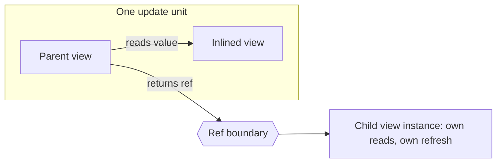
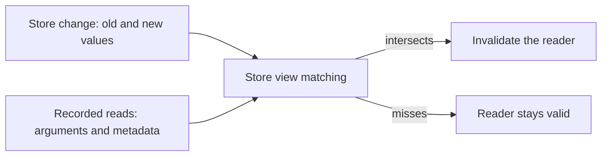

# Reactive views

See the [architecture overview](overview.md) for the broader system context,
[Stores and change feeds](stores.md) for the state views expose,
[Linking](linking.md) for how an encoded ref finds its definition again, and
[Execution](execution.md) for the process that runs a view.

Reactive views are Refresher's central primitive. A view is a side-effect-free
computation that resolves data suitable for a UI. It returns data, and it is
composed the way React composes components.

Everything else in Refresher is arranged around views: a query evaluates them,
invalidation is defined against what they read, and a live query republishes
them.

## What a view is

React separates a component, an element, and a fiber. Refresher separates the
same three things, and the correspondence is close enough to state outright:

| React                                                        | Refresher                                                            |
| ------------------------------------------------------------ | -------------------------------------------------------------------- |
| Component — a function or class in module scope              | **View definition** — its options and `resolve`, created by `view()` |
| Props — the arguments a component is invoked with            | **Arguments** — the value a view is invoked with                     |
| Element — `<Post id={id} />`, an inert description of a call | **Ref** — an inert description of a view to resolve                  |
| Fiber — the live instance behind an element                  | **View instance** — the tracked evaluation behind a ref              |
| The rendered element tree                                    | **Result graph** — values, with refs at its boundaries               |

A **definition** lives in module scope and is reached by importing it. As with
a React component, the definition object _is_ the identity, and `name` is only
a label. See [Linking](linking.md).

A **view instance** is a definition together with its arguments. Two
evaluations of one definition with equal arguments in the same session are the
same instance: they share one set of recorded reads and, when
[view caching](view-caching.md) is enabled, one cached result. The session's
[codec](codec.md) decides when two arguments are equal.

Here the parallel with React turns into a difference. React keys a fiber by its
position in the parent's output, so two parents each rendering
`<Post id="1" />` get two fibers. Refresher keys an instance by its arguments
alone, so every ref to the same view with the same arguments is one instance,
wherever it appears in the graph and however many parents point at it.

The second difference is that a view is a pure function of its inputs. It has
no counterpart to state, effects, context, or lifecycle: a view holds nothing
between evaluations, and its result depends only on its arguments and the views
it reads. Everything mutable lives in stores.

Views have two origins:

- **Store views** expose the state of a store. Views reach store state only
  through store views, which makes them the leaves of every view graph. See
  [Stores and change feeds](stores.md).
- **Derived views** are written by application developers. They read other
  views — store views or other derived views — and return values and refs.

### Tables and indexes

A second parallel comes from databases. A store is like a table, and its store
views are like the table's access paths: each one reads the store a single,
well-defined way, so each index gets a store view of its own.

```js
const messages = objectStore({
  name: "messages",
  primaryKeyPath: "id",
  indexes: { byChat: { keyPath: ["chatId", "sentAt"] } },
});

read(messages.record, id); // lookup by primary key
read(messages.primary.range, { low, high }); // range scan over the primary key
read(messages.byChat.range, { low: [chatId], high: [chatId] }); // range scan over an index
read(messages.byChat.count, { low: [chatId], high: [chatId] }); // count over an index
```

As in a database, indexes are declared with the store, and declaring an index
adds its store views. A derived view picks the access path that answers its
question, the way a query uses an index, and the choice also decides what the
read depends on: a range read over `byChat` records the interval it scanned, so
only changes that fall within that chat's interval invalidate it. See
[Read tracking](#read-tracking).

Derived views then play the role of database views: named, reusable queries
over tables and other views. Refresher's are composable like React components,
and their results stay live.

## Anatomy of a definition

```js
import { view } from "@graphitation/refresher";
import { messages } from "./stores/messages";
import { messageLikes } from "./messageLikes";

export const messageItem = view({
  name: "messageItem",
  async resolve(messageId, { read, ref }) {
    const entry = await read(messages.record, messageId);
    if (!entry.present) return null;
    return {
      id: messageId,
      body: entry.value.body,
      likes: ref(messageLikes, messageId),
    };
  },
});
```

- **Arguments** are JSON values, so equal arguments are easy to recognize and
  a ref can carry them anywhere. **Results** are ordinary values with refs in
  them. Both are checked statically by TypeScript. A session that opts into runtime validation checks them with a
  schema-aware codec. See [Codec](codec.md).
  A view whose arguments may be `undefined`, such as one that takes none, is read
  and referenced without them: `read(selectedChat)`, `ref(sidebar)`. So is an
  action that takes none: `action(toggleMenu)`.
- **Referenced views** are ordinary imports. A view reaches another view by
  importing it and passing it to `read` or `ref`, so the reference graph is the
  module graph and needs no declaration to mirror it. Bundlers can tree-shake
  views that nothing imports. See [Linking](linking.md).
- **`resolve`** computes the result: it reads other views and returns a value. `read`
  inlines a view's value; `ref` delegates it to a view instance of its own. See
  [Refs and boundaries](#refs-and-boundaries).
- **`fallback`** is an optional error representation of the view's result. See
  [Errors](errors.md#fallbacks).
- **`name`** is an optional label for traces, errors, and devtools, in the
  spirit of React's `displayName`. Two views may share one. The default
  [codec](codec.md) folds it into the local id it gives a view without an `id`.
- **`id`** is an optional id the view asks to go by outside its module, such as
  `ChatRoomV1`. The session's [codec](codec.md) issues view ids: the default
  codec uses this one as it is. Unlike `name`, it is part of the application's
  contract: refs encoded under one id break when it is renamed. See
  [Linking](linking.md#view-ids).
- **`deterministic`** declares whether `resolve` is deterministic. See
  [Determinism](#determinism).
- **`access`** declares how the view may be consumed. See [Access](#access).

### Batching reads

Execution batches reads in rounds: every read pending at the same moment is
delivered to its store view as one batch, when the store view answers with
`resolveBatch`. A view gets the most from rounds by issuing independent reads
together, so they land in the same round:

```js
async resolve(messageId, { read }) {
  // One round: both reads are known from the arguments.
  const [entry, likes] = await Promise.all([
    read(messages.record, messageId),
    read(likeCount, messageId),
  ]);

  // A dependent read needs the previous answer, so it joins the next round.
  const author = await read(users.record, entry.value.authorId);
  // ...
}
```

Sibling views benefit the same way: ten instances of `messageItem` evaluated
together issue their first reads in one round, so the store answers ten record
reads as one batch. Composition stays free of N+1 reads without any per-view
batching code. See [Execution](execution.md).

### Synchronous views

A view answers the way its `resolve` does. A `resolve` that returns its result
itself makes a synchronous view: reading it hands back the result directly, so
a render, a test, or another synchronous view can use it without awaiting. A
`resolve` that awaits makes a view that may wait, the way an `async` function makes
its callers await it.

```js
export const theme = view({
  name: "theme",
  access: { readable: true },
  resolve: (userId, { read }) => read(settings.theme, userId) ?? "light",
});
```

- **Types follow `resolve`.** The view's answer type is what `resolve` returns,
  and `read` answers with it. A synchronous view that reads a view that may
  wait fails to compile.
- **A view that may wait sometimes doesn't.** Reading it answers either way,
  since a cached instance answers at once, so its readers await.
- **Store views follow the same rule.** A store view whose `resolve` returns its
  result itself answers synchronously; its store supplies its handle at once.
  A read of a store view with `resolveBatch` may wait, since its batch is
  answered once the round forms; one that answers synchronously still lets
  its wave settle in the calling task.
- **Waves follow suit.** A wave settles in the calling task when every instance
  it reaches answered synchronously. See [Rounds](execution.md#rounds).

Changing a view's `resolve` between synchronous and awaiting changes what its
readers receive, the way making a function `async` does.

### Rules for `resolve`

`resolve` must be **side-effect-free**. It reads views and returns values and refs,
and does nothing else: it performs no writes, network requests, or timers, and
mutates no state outside its own result. Network data reaches a view through a
store, whose owner decides when to fetch it.

It must also treat what it reads as immutable. Values returned by `read`
may be shared with other views and consumers.

### Determinism

A view is **deterministic** when equal arguments over equal inputs always
produce an equal result. This is a separate and weaker property than being
side-effect-free. Reading a clock, a random source, or anything else outside its
arguments and its reads makes a view non-deterministic, and it must
declare `deterministic: false`.

Views are deterministic by default, and determinism is what lets Refresher
reuse a result whose inputs are unchanged. Deterministic views may consume only
deterministic views, so a view that reads or refs a non-deterministic view must
declare itself non-deterministic too. Time-dependent data is best modelled as a
store, such as a clock store that changes once a minute: views that read it stay
deterministic and rerun when it changes. See
[Guarantees](guarantees.md#determinism).

## Refs and boundaries

A view consumes another view in one of two ways, and the choice is the main
design decision in a Refresher data layer: it decides what recomputes together
and what recomputes alone.

**Reading** a view inlines its value into the caller's own result, and the
caller depends on it: whenever the callee's result changes, the caller reruns.
The dependency runs one way. A callee recomputes only when its own inputs
change, so when its caller reruns it may answer from its cache, if view caching
is enabled. A read that fails is the caller's failure.

**Returning a ref** delegates it. A ref pairs a view with its arguments and is
analogous to a React element. The referenced view resolves as its own view
instance and refreshes without rerunning its parent or children. When it
resolves — in the same result, streamed later in the spirit of GraphQL's
`@defer`, or only on demand — is up to the
[query driver](execution.md). A ref is also
serializable: encoded as data, it addresses its view by its view id, which
lets it cross a worker boundary or survive a reload.
See [Linking](linking.md).

Like a React element, a ref is a frozen record anyone may read: its `view`, its
`args` as captured, and its `meta`. `ref(view, args, meta)` sets the meta, which
carries whatever a query driver selects refs by, such as `tags`. Refs that differ
only in meta lead to the same instance. Drivers declare any other meta they read
by merging into the `RefMetaExtensions` interface. `isRef` tells a ref from data shaped like
one, so a value decoded from elsewhere never passes for a ref.

`action(target, args, meta)` makes the other kind of ref, an **action ref**,
to an action of the application's own: a typed address the UI runs,
which names its `action` where a view ref names its `view`. An action ref is
never evaluated or read, and creates no boundary: it is part of its view's
value. See [Actions](actions.md).

Arguments hold no refs. A view passes its child what the child needs, its id
or its fields, and returns the ref itself, as a component passes props rather
than elements. So every ref in a result is one a view made with `ref`. A
ref in arguments is a **value** error: the JSON codec rejects it at
runtime. An [external ref](federation.md#reading-external-refs) is a string or
a number, so views take it as an argument like any other data.

An argument a view does not know, such as the size of a page to load, is an
[open input](variables.md): `ref(chatMessages, { chatId, first: input("first") })`
makes a template, which its consumer binds with a value before following it.

> **Open.** Whether an encoded ref carries its meta is open.



A ref creates three boundaries at once, which makes it the unit of update, much
as a component boundary decides what re-renders in React:

- **An update boundary.** Invalidating the child leaves the parent untouched,
  and invalidating the parent leaves the child untouched. A view in the middle
  of a result tree may therefore refresh while its parent and children stay as
  they are, as long as the refs between them keep equal arguments. See
  [Invalidation](invalidation.md).
- **A sharing boundary.** The referenced instance is shared by every parent
  that refers to it with equal arguments, and with view caching enabled its
  result is cached under its own identity. See
  [View caching](view-caching.md).
- **An error boundary.** A failure inside the referenced view stops at the ref.
  The ref resolves to the view's fallback result, if it defines one, or to
  `null` with a reported error; the parent and its siblings are unaffected. How
  a contained failure is presented is up to the query driver. See
  [Errors](errors.md).

A ref also lets a result graph contain cycles while materialized results stay
trees: an already-visited instance stays a ref in the graph and is evaluated
only once. See [Execution](execution.md).

## Access

A view controls how it can be consumed by declaring whether it is **readable**,
**referenceable**, and **queryable**. The three are independent. Consuming a view
the wrong way is a type error at the call site and a failure at runtime.

The built-in default is **referenceable and unreadable**. Composition by ref is
the arrangement Refresher is built around: it makes a view instance shareable,
independently refreshable, and isolated from a sibling's failure. Reading a view
inline fuses it into its caller and gives all of that up, so it is an exception
a view opts into explicitly.

**Store views invert the default: readable and unreferenceable.** A store view
is a leaf, and reading one is what a derived view is for. Referencing one would
publish the store's own shape as part of the application's contract, so a store
opts into it explicitly, per store view, where an address is exactly what is
wanted.

**Queryable views are entry points.** Only a queryable view may be the root of
a query, the way only some components are mounted at a route. A query is where
an application, a component, or another session starts reading. Every other
view is reached from a root, through `read` or `ref`, and is not queryable
unless it opts in:

```js
export const chatRoom = view({
  access: { queryable: true },
  resolve: (chatId, { ref }) => ({ messages: ref(chatMessages, chatId) }),
});
```

**Pins are never readable.** A [pin](pins.md) answers with a ref to its
target, which only a query keeps.

**A ref is never read.** A view that receives a ref holds it, passes it on, or
returns it, and the query driver follows it to the view or component it
reaches. Reading a ref would make every referenceable view readable through the
back door; keeping the two apart keeps both access modes meaningful, and keeps
every inlined dependency visible at the call site.

## Read tracking

Every store view read is recorded against the view instance that performed it.
The record holds the read's arguments and any metadata the read returned, such
as where a limited page stopped or a pagination cursor. The values themselves
are needed only when the result is cached. See
[Invalidation](invalidation.md).

Interpreting that record is the store view's job. When a change arrives, each
store view tests it against the reads recorded for it and decides whether the
change could affect them. The store view defines what its arguments mean — a
key, a range, a filter — so it is also the one that knows how a change relates
to them. Matching must catch every relevant change, and may conservatively
over-match.



The arguments decide what a store view can test. Some examples:

- **Record lookup.** The argument is a key, and a change matches when it
  touches that key. This includes a record appearing under a key that was
  missing when it was read.
- **Range scan over an index.** The arguments are bounds over the index key. A
  change matches when the changed record's old or new index key falls within
  them: the new key catches a record entering the range, the old key catches
  one leaving it. When a limited read stops early, the metadata it returns
  narrows the match to the interval it actually covered.
- **Count.** The same bounds as a range scan, but a change matches only when a
  record enters or leaves them. Edits to records that stay within the bounds
  leave the count valid.
- **Filtered slice.** The arguments include a filter and its parameters, and
  the store view evaluates the filter against the change's old and new values.
  A change that passes neither leaves the read valid, wherever it lands in the
  collection.
- **Field selection.** The arguments name the fields the reader needs, and a
  change matches only when it touches one of them, so a write to
  `user.lastSeenAt` leaves a read of `user.displayName` valid.

Matching relies on what a change reports, such as the old and new values of a
changed record. See [Stores and change feeds](stores.md).

### Designing store views

Store view design is what makes invalidation efficient. A store view can test a
change only against what its arguments describe, so the question a view asks
belongs in the arguments of the store view it reads.

Compare two ways of finding a chat's unread messages. The first reads every
message in the chat and filters in `resolve`, so it depends on the whole chat,
and any new message reruns it:

```js
const unread = view({
  resolve: async (chatId, { read }) => {
    const all = await read(messages.byChat.range, {
      low: [chatId],
      high: [chatId],
    });
    return all.filter((message) => !message.read);
  },
});
```

The second reads a store view that takes the filter as part of its arguments.
Its matching can test each change against the filter, so only messages that
are or were unread in that chat invalidate it. A pseudo-implementation of its
matching:

```js
// Pseudo-implementation: does a change affect a read of unreadMessages(chatId)?
function affects(change, chatId) {
  return [change.oldValue, change.newValue].some(
    (message) =>
      message !== undefined && message.chatId === chatId && !message.read,
  );
}
```

A few guidelines follow:

- **Put the question in the arguments.** Filters, bounds, and field selections
  a store view receives are what it can test; filtering in a derived view's `resolve`
  turns a narrow question into a broad dependency.
- **Prefer slices for growing collections.** A read that returns a complete
  collection depends on all of it, so a single insert anywhere reruns every
  reader. A bounded slice depends only on the interval it covered.
- **Test both old and new values.** The old value says where a record was, the
  new value where it is now. Testing both detects a record leaving a read as
  reliably as one entering it.
- **Return metadata that narrows the dependency.** A page that reports where it
  stopped depends only on what it covered, and stays valid when records arrive
  past its end.
- **Keep matching cheap.** Matching runs for every change, so a store view
  should find the reads a change could affect without testing all of them — for
  example, by grouping recorded reads by key or by index prefix.

The [database index](#tables-and-indexes) is the mental model here too. An index
declares its sorting columns — or object properties — and that declaration lets
a store search ranges efficiently by prefix and lets a range read name the exact
interval it depends on.

How slices are addressed over time — cursors, pages, anchored segments, and live
windows — is a separate concern, covered in [pagination](pagination.md).
